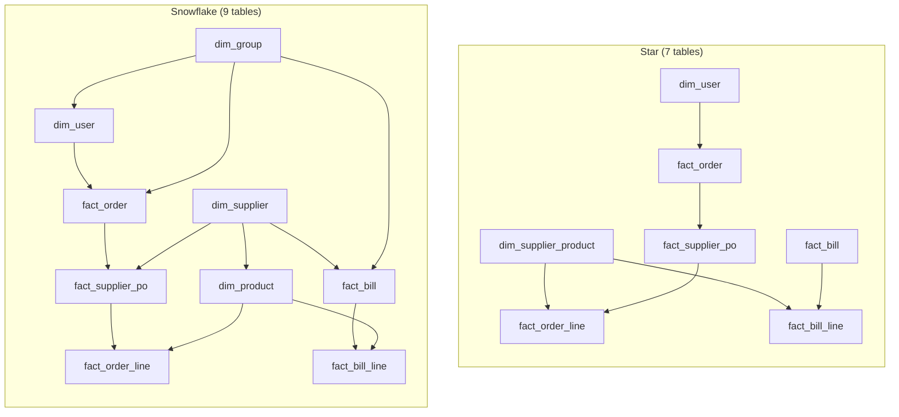

# super-duper-funicular

An end-to-end ETL pipeline that moves procurement data (users, orders and supplier bills) from MongoDB into an analytics-ready Postgres database, using a **medallion architecture** (bronze, silver, gold) on a Delta lakehouse.

## Contents

- [1. Overview](#1-overview)
- [2. Architecture](#2-architecture)
- [3. ETL pipeline, step by step](#3-etl-pipeline-step-by-step)
- [4. Data models](#4-data-models)
- [5. Star vs snowflake: comparison and decision](#5-star-vs-snowflake-comparison-and-decision)
- [6. Data quality](#6-data-quality)
- [7. Security and PII](#7-security-and-pii)
- [8. Repository structure](#8-repository-structure)
- [9. Documentation index](#9-documentation-index)
- [10. Known limitations and open items](#10-known-limitations-and-open-items)

## 1. Overview

| Topic | Decision |
|---|---|
| Source | MongoDB collections: `users`, `orders`, `bills` (plus a supplier product source, still to be confirmed) |
| Processing style | Batch. Scheduled jobs run, finish and stop. Nothing is streamed. |
| Lakehouse format | Delta tables (Databricks with cloud object storage assumed) |
| Layers | Landing zone → Bronze → Silver → Gold → Postgres |
| Serving database | Postgres, read-only, full snapshot on every run |
| Gold model published | Star schema (a snowflake variant is documented as an alternative) |
| Business questions answered | 10 (order counts and value, monthly trend, top products, top suppliers, billed totals, bill status counts, billed products, orders per user, average order value per user) |

## 2. Architecture

Click the image to open it at full size. The SVG zooms without losing sharpness. A PNG copy is in [etl_architecture_diagram.png](doc/etl_architecture_diagram.png).


How to read it:

- Each coloured block is one stage: green is the source, teal is the landing zone, orange is bronze, grey is silver, gold is gold, blue is Postgres, purple is the consumers.
- Arrows show the direction of the data. The text beside each arrow is the step that moves data to the next stage.
- The dashed red box is the reject path: documents that fail validation in silver are written to `silver_rejects` and retried when a newer version arrives.

## 3. ETL pipeline, step by step

### 3.1 Extract: MongoDB to landing zone

| Topic | Rule |
|---|---|
| Method | A scheduled export job writes files to cloud object storage. The bronze load never reads the live database. |
| Format | MongoDB extended JSON, so wrappers such as `$oid` and `$date` are kept. |
| Layout | One folder per collection, then one folder per run date. Files are written once. |
| Incremental rule | Export documents whose `_meta.at` is later than the last successful export, with a small overlap window for late writes. |
| First run | Full export of every collection. |
| Duplicates | The overlap window can deliver the same version twice. Bronze keeps both. Silver keeps one. |

### 3.2 Load: landing zone to Bronze

Bronze is the first copy of the data. Nothing is cleaned, typed or renamed. It is the replay point if anything goes wrong downstream.

| Step | What happens |
|---|---|
| 1. Find new files | Compare the landing folder with the Auto Loader checkpoint. Only unseen files are picked up. |
| 2. Read as they are | Values stay as text. Nested objects and arrays keep their shape. |
| 3. Add load metadata | `bronze_ingested_at`, `bronze_batch_id`, `bronze_source_file` are added to every row. |
| 4. Set aside misfits | Fields that do not fit the schema go to `bronze_rescued_data`. Nothing is dropped. |
| 5. Append to Delta | Rows are added. Existing rows are never changed. |
| 6. Record and check | The checkpoint is updated, and file and row counts are compared. |

Re-runs are safe because already-loaded files are skipped.

| Bronze table | Source | Feeds silver |
|---|---|---|
| `bronze.users` | `users` | `USERS`, `USER_ITEM` |
| `bronze.orders` | `orders` | `ORDERS`, `ORDER_SUPPLIER_PO`, `ORDER_LINE` |
| `bronze.bills` | `bills` | `BILLS`, `BILL_LINE` |
| `bronze.supplier_product` | To be confirmed | `SUPPLIER_PRODUCT` |

### 3.3 Transform: Bronze to Silver

Silver is built in **4 phases and 11 steps**. Only bronze batches not yet recorded as processed are read.

| Phase | Step | What happens |
|---|---|---|
| Prepare | 1. Select new rows | Read unprocessed batches. Rows with no document id are rejected. |
| Prepare | 2. Keep latest version | One row per document id, by latest `_meta.at`. Bills break ties on `tlm`, others on `bronze_ingested_at`. |
| Shape | 3. Flatten and rename | `_id.$oid` becomes a text key. `meta_*` becomes `src_*`. Phone fields merge. Address lines are joined. |
| Shape | 4. Split into child rows | Cart and price items, supplier POs, order lines and bill lines become child tables. `SUP:SKU` keys are split on the first colon. |
| Clean | 5. Convert types | UTC timestamps, `DATE`, `DECIMAL(12,2)` amounts, `DECIMAL(12,4)` unit prices, booleans, arrays and maps. A failed conversion becomes null and is logged. |
| Clean | 6. Handle nulls | Empty and placeholder values become null. Amounts are never filled or guessed. |
| Clean | 7. Clean text | UTF-8 repair, hidden characters removed, trimming. Free-text fields are kept as printed. |
| Clean | 8. Apply business rules | Four derived columns: `is_test`, `supplier_order_id`, `po_status`, `channel`. |
| Load | 9. Add audit columns | `silver_loaded_at`, `src_meta_at`, `src_trace_id`, `src_meta_src`, `bronze_ingested_at`. |
| Load | 10. Validate | Key, required-column and rule checks. Failures go to `silver_rejects`. |
| Load | 11. Write | Parents are upserted by key. Child rows are replaced together with their parent in one commit. |

Reject scope: a bad `USERS` or `SUPPLIER_PRODUCT` row rejects that row only. A bad `USER_ITEM` rejects that item only. A bad order or bill rejects the whole document, so totals never come from a partly loaded order.

Silver can always be rebuilt in full from bronze.

### 3.4 Model: Silver to Gold

Gold is built in dependency order. Orders and bills can run in parallel once the dimensions are done.

| Step | Tables (star) | Notes |
|---|---|---|
| 1 | `dim_user`, `dim_supplier_product` | Test users removed. PII columns not carried. |
| 2 | `fact_order` | Orders from test users removed. |
| 3 | `fact_supplier_po` | Only POs of kept orders. |
| 4 | `fact_order_line` | Only lines of kept orders. |
| 5 | `fact_bill`, `fact_bill_line` | Independent of the order branch. |

Gold rules: every column is a silver column under its silver name, with no surrogate keys, no derived measures and no PII. A fact row whose user, supplier or product has no dimension row is kept, not dropped.

### 3.5 Publish: Gold to Postgres

| Topic | Rule |
|---|---|
| Refresh | Full snapshot each run, loaded into a staging schema and swapped in as one step. |
| Direction | One way, Delta to Postgres. Never read back. |
| Content | Gold tables as they are: same names, same columns, no PII. |
| Types | Direct mapping: `STRING`→`text`, `INT`→`integer`, `DECIMAL(12,2)`→`numeric(12,2)`, `DECIMAL(12,4)`→`numeric(12,4)`, `BOOLEAN`→`boolean`, `DATE`→`date`, `TIMESTAMP`→`timestamptz`, `ARRAY<STRING>`→`text[]`. No rounding or recasting. |
| Primary keys | Created and enforced. A duplicate key fails the load. |
| Foreign keys | Not created. Some fact rows have no dimension row by design, and an enforced key would reject them and break totals. |
| Access | A read-only role for analysts and BI tools. |

## 4. Data models

| Layer | Tables | Grain and purpose |
|---|---|---|
| Bronze | 4 | One row per document version, exactly as received. |
| Silver | 8 (`USERS`, `USER_ITEM`, `SUPPLIER_PRODUCT`, `ORDERS`, `ORDER_SUPPLIER_PO`, `ORDER_LINE`, `BILLS`, `BILL_LINE`) | One row per key, latest version, typed and cleaned. |
| Gold (star) | 7 (2 dimensions, 5 facts) | Business model for the 10 questions. |
| Gold (snowflake) | 9 (4 dimensions, 5 facts) | Same facts, dimensions normalized further. |

Entity-relationship diagrams:

- Silver: [`silver_er_diagram.png`](data%20models/silver/silver_er_diagram.png)
- Gold, star: [`star_model_er_diagram.svg`](data%20models/gold/star_model/star_model_er_diagram.svg)
- Gold, snowflake: [`snowflake_er_diagram.svg`](data%20models/gold/snowflake_model/snowflake_er_diagram.svg)

## 5. Star vs snowflake: comparison and decision

Both gold models share the **same five fact tables** with the same columns. They differ only in how the dimensions are organized.



| Criterion | Star | Snowflake |
|---|---|---|
| Tables | 7 (2 dimensions, 5 facts) | 9 (4 dimensions, 5 facts) |
| Dimensions | `dim_user`, `dim_supplier_product` | `dim_group`, `dim_user`, `dim_supplier`, `dim_product` |
| Supplier and product | One combined table at supplier and SKU grain | Split: `dim_supplier` (one row per supplier) and `dim_product` (one row per SKU) |
| Redundancy | `supplier_name` repeats on every SKU row of a supplier | Supplier name stored once in `dim_supplier` |
| Join depth | One hop from fact to dimension | Up to two hops (fact → product → supplier, user → group) |
| Query simplicity | Simpler SQL, fewer joins | More joins, but each dimension is smaller |
| Supplier-level reports (question 2b) | `fact_supplier_po` has no direct dimension link. Sum by `supplier_code` first, then look up the name once through `fact_order_line` (open item G11). | `fact_supplier_po` joins `dim_supplier` directly on `supplier_code`. |
| Group analysis | `group_id` is a plain column on `dim_user`, `fact_order`, `fact_bill` | `dim_group` is a shared table linking users, orders and bills, the only common level between orders and bills |
| Silver fidelity | Every table is a silver table | `dim_group` is the one table that is not a silver table (built from distinct `group_id` values) |
| Pitfall | Joining `fact_supplier_po` or `fact_bill` to the dimension on `supplier_code` alone repeats totals once per SKU | `dim_supplier` is built from distinct code and name pairs, so a code with more than one name or a null name needs a rule to keep the key unique |
| Postgres load | Fewer tables to publish and check | Two more tables and extra key checks |
| BI usability | Easier for analysts to understand and query | Better when conformed dimensions are needed across facts |

### Decision

**The star schema is the published model.** Reasons:

1. **Scale fits a star.** The model is built for 10 business questions, and a handful of tables serves them directly.
2. **Simplicity for BI users.** One join from fact to dimension is easier for analysts and BI tools, and the serving database does not enforce foreign keys anyway.
3. **No extra invented table.** Every star table is a silver table. The snowflake adds `dim_group`, which has no attributes because silver has no group master.
4. **The redundancy is small.** The only repeated value is `supplier_name` on product rows, which is a minor storage cost.

**When to switch to snowflake:** if supplier-level reporting becomes central (a direct `fact_supplier_po` → `dim_supplier` join removes the G11 workaround), if a group master appears in silver so `dim_group` gains real attributes, or if group-level analysis across orders and bills is needed.

## 6. Data quality

Checks run at every layer. Details are in each layer's document.

| Layer | Checks |
|---|---|
| Bronze | Every new file loaded exactly once. Row counts match the files. Zero-file batches reported. Rescued-data share and new top-level fields tracked. Freshness alert. |
| Silver | Primary keys unique and not null. One row per document after the latest-version pick. Every child has a parent. Orphan rate against `SUPPLIER_PRODUCT` recorded. `po_status` and `channel` values valid. Per-batch rejection rate (warn above 0.5%, fail above 5%) and conversion failure rate (warn above 1%). Child row counts equal bronze array lengths. |
| Gold | Primary keys unique. Row counts match silver (only gap is test users, logged). `total_amt` and bill `total` sums match silver. Every child fact has a parent fact. Share of facts with no dimension row recorded. No PII column exists in any gold table. |
| Postgres | Primary key enforced, so a duplicate fails the load. |

A failed silver run stops before gold is built, so gold never sees a half-updated order.

## 7. Security and PII

| Layer | Access and PII handling |
|---|---|
| Bronze | Unmasked. Holds personal data and the `password` field. Only the pipeline service identity can read it. Encrypted at rest. Recovering a value such as `_meta.by` goes through a logged, approved request. |
| Silver | Personal data kept raw but classified per column (PII-direct, PII-contact, PII-business) and protected by access control. `password` never enters silver. |
| Gold | No PII-direct or PII-contact columns. Users are labelled by `clinic_name`. Orders from test users are excluded. |
| Postgres | Read-only role for analysts and BI tools. Contains gold only. |
| Erasure | Deletion requests are keyed on `user_id` and must reach bronze, silver and older Delta file versions within the retention policy. |

## 8. Repository structure

```text
super-duper-funicular/
├── babel.json
├── data models/
│   ├── bronze/
│   │   └── bronze_layer.md
│   ├── silver/
│   │   ├── silver_layer.md
│   │   └── silver_er_diagram.png
│   ├── gold/
│   │   ├── star_model/
│   │   │   ├── gold_layer.md
│   │   │   └── star_model_er_diagram.svg
│   │   └── snowflake_model/
│   │       ├── gold_layer.md
│   │       └── snowflake_er_diagram.svg
│   └── postgres_layer/
│       └── postgres_layer.md
├── doc/
│   ├── data_dictionary.md
│   ├── etl_architecture_diagram.svg
│   └── etl_architecture_diagram.png
├── LICENSE
└── README.md
```

## 9. Documentation index

| Document | What it covers |
|---|---|
| [Bronze layer](data%20models/bronze/bronze_layer.md) | Landing zone, Auto Loader ingestion, added columns, storage, security, checks |
| [Silver layer](data%20models/silver/silver_layer.md) | 8 tables, columns, relationships, cleaning rules, PII classes, the 11 build steps, monitoring |
| [Gold layer, star](data%20models/gold/star_model/gold_layer.md) | 7 tables, business questions, silver-to-gold mapping, checks |
| [Gold layer, snowflake](data%20models/gold/snowflake_model/gold_layer.md) | 9 tables, snowflake levels, build order, checks |
| [Postgres layer](data%20models/postgres_layer/postgres_layer.md) | Publish step, type mapping, constraints |
| [Data dictionary](doc/data_dictionary.md) | Every field of the `users`, `orders` and `bills` source documents, with the guessed meanings listed for confirmation |

## 10. Known limitations and open items

| # | Item | Impact |
|---|---|---|
| 1 | Source of `SUPPLIER_PRODUCT` is not confirmed | Product dimension and name conflict rules depend on it |
| 2 | Bill supplier codes may not match order-side or product codes | Bill-to-product matching may be low. A supplier code mapping may be needed. |
| 3 | Bills have no user or order link | Bills cannot be split by user. `group_id` is the only bridge. |
| 4 | `ORDERS.total_amt` includes failed suppliers | Accepted order value is the sum of `po_status = 'SUCCESS'` PO totals |
| 5 | Silver and gold keep the latest version only | Status changes over time cannot be analyzed without a history table |
| 6 | Deleted source documents are not detected by incremental export | An occasional full export is proposed. How silver treats deletions is undecided. |
| 7 | Bill status values (pending, approved, disputed) are unknown | Counts run on raw `status` text until distinct values are known |
| 8 | Meaning of `price` on lines is assumed to be the line total | To be confirmed with the data owner |
| 9 | Data volume is not known | Partitioning and sizing decisions are deferred |
| 10 | Documentation gaps | The Postgres layer document does not yet cover the Redshift comparison, and the bronze document refers to `bronze_ingestion_diagram.svg`, which is not in the repository |

## License

See [LICENSE](LICENSE).