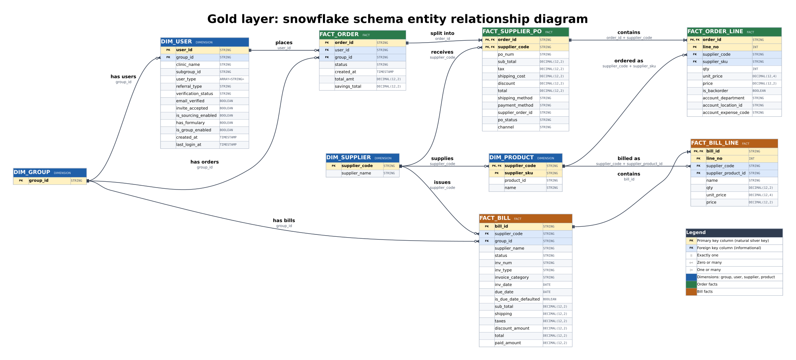
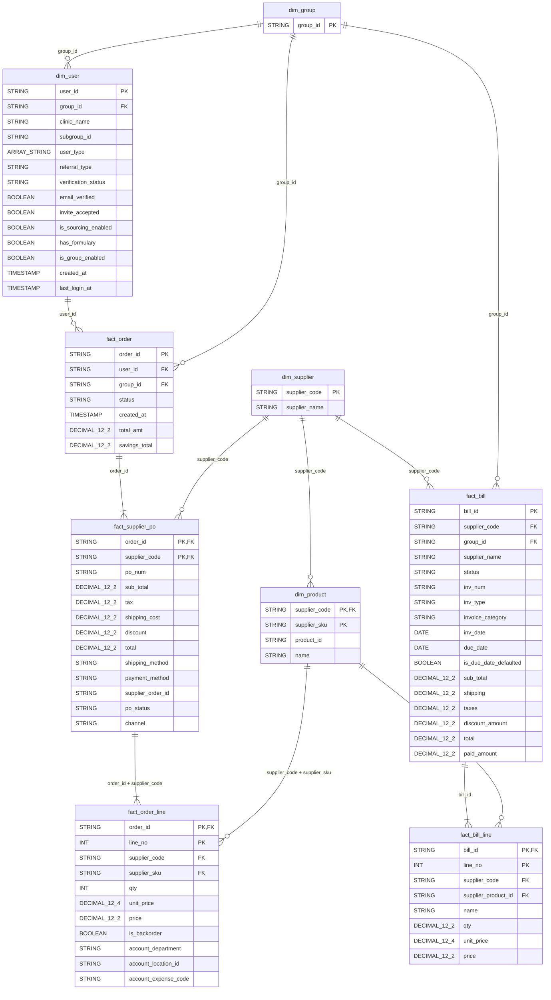

# Gold Layer Data Model (Snowflake)

This document defines the gold layer as a **snowflake schema**: the same five facts as the star version, with the dimensions normalized into further tables where silver supports it.

**Rule.** Every column comes from a silver column under its silver name. There are no surrogate keys, derived measures, calendar table or audit columns. The one table that is not a silver table, `dim_group`, holds only values that already exist in silver (see G11).

## Contents

- [1. Overview](#1-overview)
- [2. Business questions and where they are answered](#2-business-questions-and-where-they-are-answered)
- [3. ER diagram](#3-er-diagram)
- [4. Table inventory](#4-table-inventory)
- [5. Snowflake levels](#5-snowflake-levels)
- [6. Design principles](#6-design-principles)
- [7. Table specifications](#7-table-specifications)
- [8. Data quality checks](#8-data-quality-checks)
- [9. Assumptions and open items](#9-assumptions-and-open-items)
- [10. Build order](#10-build-order)

## 1. Overview

Gold has **9 tables**: **4 dimensions** and **5 facts**.

| Group | Facts | Grain |
|---|---|---|
| Orders | `fact_order`, `fact_supplier_po`, `fact_order_line` | Order, purchase order (order and supplier), order line |
| Bills | `fact_bill`, `fact_bill_line` | Bill, bill line |

| Dimension | Role |
|---|---|
| `dim_group` | Outer level. Group of users, referenced by users, orders and bills. |
| `dim_user` | Users. Points to `dim_group`. |
| `dim_supplier` | Outer level. Suppliers. |
| `dim_product` | Products. Points to `dim_supplier`. |

Compared with the star version (`gold_layer.md`):

- **Added:** `dim_group`, which gives orders, bills and users one shared group table.
- **Changed:** `dim_product` no longer repeats supplier data. It holds `supplier_code` and reaches the name through `dim_supplier`. `dim_user.group_id`, `fact_order.group_id` and `fact_bill.group_id` become foreign keys to `dim_group`.
- **Unchanged:** the five facts and their columns.

Three facts about the data still shape the design:

- **Bills have no user and no order link.** `group_id` through `dim_group` is the only shared level between the order and bill sides.
- **`ORDERS.total_amt` includes failed suppliers.** The accepted value is the sum of `ORDER_SUPPLIER_PO.total` where `po_status = 'SUCCESS'`.
- **Product and supplier references are incomplete.** A fact row with no matching product or supplier row is kept. Order and bill lines carry their own `supplier_code`, so they can still be grouped by supplier directly.

## 2. Business questions and where they are answered

| # | Area | Question | Tables | Calculation | Filter |
|---|---|---|---|---|---|
| 1a | Order analysis | How many orders are placed? | `fact_order` | Row count | None |
| 1b | Order analysis | What is the total order value? | `fact_order` | Sum of `total_amt` | None (see G1) |
| 1c | Order analysis | How do orders trend monthly? | `fact_order` | Row count and sum of `total_amt`, grouped by month of `created_at` | None |
| 2a | Product and supplier | Which products are ordered most? | `fact_order_line` → `dim_product` → `dim_supplier` | Sum of `qty`, and distinct `order_id`, by product. The supplier name comes from `dim_supplier` | None. Failed POs still count as demand |
| 2b | Product and supplier | Which suppliers receive the highest order value? | `fact_supplier_po` → `dim_supplier` | Sum of `total` by `supplier_code` | `po_status = 'SUCCESS'` |
| 3a | Bill analysis | What is the total billed amount? | `fact_bill` | Sum of `total` | None |
| 3b | Bill analysis | How many bills are pending, approved or disputed? | `fact_bill` | Row count by `status` | None (see G4) |
| 3c | Bill analysis | Which products and quantities are billed? | `fact_bill_line` → `dim_product` | Sum of `qty` and `price` by product | None |
| 4a | User analysis | Which users place the most orders? | `fact_order` → `dim_user` | Row count by `user_id`, descending | None |
| 4b | User analysis | What is the average order value per user? | `fact_order` → `dim_user` | Sum of `total_amt` divided by row count, by `user_id` | None |

Rules for using the facts correctly:

- Use each question's own table. Joining `fact_order` to a lower-grain fact repeats `total_amt` once per child row.
- To count orders from `fact_supplier_po` or `fact_order_line`, count distinct `order_id`.
- For a user label in 4a, use `clinic_name`. Names and emails are not in gold.

## 3. ER diagram

Click the image to open it at full size. The SVG zooms without losing sharpness. A PNG copy is in [snowflake_er_diagram.png](snowflake_er_diagram.png).

How to read it:

- Yellow rows are primary key columns, blue rows are foreign key columns that are not part of the primary key. `PK, FK` marks a column that is both.
- Blue headers are dimensions, green headers are order facts, orange headers are bill facts. The colours are the same as in the star diagram.
- Line ends use crow's foot notation. `||` is exactly one, `o<` is zero or many, `|<` is one or many. The line label gives the relationship name and the join columns.
- Every column of every gold table is drawn. Section 7 adds the silver source of each column.
- Foreign keys are informational, as in silver.

Mermaid source (renders directly in GitHub and most markdown viewers)

Mermaid type names cannot contain commas or angle brackets, so `DECIMAL(12,2)` is written `DECIMAL_12_2` and `ARRAY<STRING>` is `ARRAY_STRING`. The tables in section 7 use the real types.

## 4. Table inventory

| Table | Type | Grain | Primary key | Built from (silver) |
|---|---|---|---|---|
| `dim_group` | Dimension (outer) | One row per group id | `group_id` | Distinct `group_id` from `USERS`, `ORDERS`, `BILLS` |
| `dim_supplier` | Dimension (outer) | One row per supplier code | `supplier_code` | `SUPPLIER_PRODUCT` |
| `dim_product` | Dimension | One row per supplier and SKU | `supplier_code`, `supplier_sku` | `SUPPLIER_PRODUCT` |
| `dim_user` | Dimension | One row per user | `user_id` | `USERS` |
| `fact_order` | Fact | One row per order | `order_id` | `ORDERS` |
| `fact_supplier_po` | Fact | One row per order and supplier | `order_id`, `supplier_code` | `ORDER_SUPPLIER_PO` |
| `fact_order_line` | Fact | One row per order line | `order_id`, `line_no` | `ORDER_LINE` |
| `fact_bill` | Fact | One row per bill | `bill_id` | `BILLS` |
| `fact_bill_line` | Fact | One row per bill line | `bill_id`, `line_no` | `BILL_LINE` |

## 5. Snowflake levels

| Path | Levels | What is normalized |
|---|---|---|
| Product to supplier | `fact_order_line` or `fact_bill_line` → `dim_product` → `dim_supplier` | Supplier name is stored once in `dim_supplier`, not on every product row. |
| User to group | `fact_order` → `dim_user` → `dim_group` | Group is its own table, shared with `fact_order` and `fact_bill`. |
| Order header to detail | `fact_order_line` → `fact_supplier_po` → `fact_order` | Same hierarchy as silver. Header amounts stay on the header fact. |
| Bill header to detail | `fact_bill_line` → `fact_bill` | Same hierarchy as silver. |

Not snowflaked, and why:

- **Status and type text** (`status`, `po_status`, `channel`, `shipping_method`, `payment_method`, `inv_type`, `invoice_category`, `referral_type`, `verification_status`). A lookup table here would hold only the value itself and add a join with no attribute.
- **Subgroup.** Silver has `subgroup_id` and `subgroup_ids` but no subgroup table, and the group-to-subgroup hierarchy is assumed, not confirmed. It stays a plain column on `dim_user`.
- **Date.** A calendar table is not in silver. Months come from `created_at`.
- **Role and department.** Not carried to gold.

## 6. Design principles

| # | Principle | How it is applied |
|---|---|---|
| 1 | **Silver columns only** | Each gold column is a silver column under its silver name. Nothing is derived. |
| 2 | **Natural keys** | Gold joins on silver keys. There are no surrogate keys. |
| 3 | **Normalize only what silver supports** | A dimension is split only where silver has the repeated attribute and a clear parent (supplier on product, group on user). |
| 4 | **Facts keep their keys** | A fact row whose user, group, supplier or product has no dimension row is kept as is. Nothing is dropped and no placeholder row is added. The share of such rows is recorded (check 5). |
| 5 | **No PII in gold** | Silver PII-direct and PII-contact columns are excluded: `email`, `fname`, `lname`, `phone_nos`, `street`, `city`, `state`, `zip_code`, `shipping_address`, `order_email`, `bill_to`, `ship_to`, `approval_info`. The business address fields `supplier_address` and `remit_to` are also left out. |
| 6 | **Test users are excluded** | Orders from users with `is_test = true` in silver are not loaded. Their purchase orders and lines follow the order. See G3. |
| 7 | **Latest version only** | Silver keeps one version per key, so gold does too. See G8. |
| 8 | **Silver types** | `DECIMAL(12,2)` for amounts, `DECIMAL(12,4)` for unit prices, UTC `TIMESTAMP`, `DATE` for calendar dates. |
| 9 | **Naming** | Table names are `snake_case` with a `dim_` or `fact_` prefix. Column names are unchanged from silver. |

## 7. Table specifications

Dimensions first, outer levels before the tables that point to them, then facts. **Source** is the silver column.

### 7.1 dim_group

- **Grain:** One row per group id.
- **Source:** Distinct non-null `group_id` from `USERS`, `ORDERS` and `BILLS`.
- **Primary key:** `group_id`

| # | Column | Type | Key | Source |
|---|---|---|---|---|
| 1 | `group_id` | `STRING` | PK | `USERS.group_id`, `ORDERS.group_id`, `BILLS.group_id` |

Silver has no group master, so the table has no attributes. Attributes can be added when a master exists (G11).

### 7.2 dim_supplier

- **Grain:** One row per supplier code.
- **Source:** Distinct `supplier_code` and `supplier_name` from `SUPPLIER_PRODUCT`.
- **Primary key:** `supplier_code`

| # | Column | Type | Key | Source |
|---|---|---|---|---|
| 1 | `supplier_code` | `STRING` | PK | `SUPPLIER_PRODUCT.supplier_code` |
| 2 | `supplier_name` | `STRING` |  | `SUPPLIER_PRODUCT.supplier_name` (nullable in silver) |

### 7.3 dim_product

- **Grain:** One row per supplier and SKU.
- **Source:** `SUPPLIER_PRODUCT`. The supplier name is not repeated here.
- **Primary key:** `supplier_code`, `supplier_sku`
- **Parent:** `dim_supplier` on `supplier_code`

| # | Column | Type | Key | Source |
|---|---|---|---|---|
| 1 | `supplier_code` | `STRING` | PK, FK | `SUPPLIER_PRODUCT.supplier_code` |
| 2 | `supplier_sku` | `STRING` | PK | `SUPPLIER_PRODUCT.supplier_sku` |
| 3 | `product_id` | `STRING` |  | `SUPPLIER_PRODUCT.product_id` |
| 4 | `name` | `STRING` |  | `SUPPLIER_PRODUCT.name` |

### 7.4 dim_user

- **Grain:** One row per user (latest silver version).
- **Source:** `USERS`, test users removed, PII columns left out.
- **Primary key:** `user_id`
- **Parent:** `dim_group` on `group_id`

| # | Column | Type | Key | Source |
|---|---|---|---|---|
| 1 | `user_id` | `STRING` | PK | `USERS.user_id` |
| 2 | `group_id` | `STRING` | FK | `USERS.group_id` |
| 3 | `clinic_name` | `STRING` |  | `USERS.clinic_name` (display label for user reports) |
| 4 | `subgroup_id` | `STRING` |  | `USERS.subgroup_id` |
| 5 | `user_type` | `ARRAY<STRING>` |  | `USERS.user_type` |
| 6 | `referral_type` | `STRING` |  | `USERS.referral_type` |
| 7 | `verification_status` | `STRING` |  | `USERS.verification_status` |
| 8 | `email_verified` | `BOOLEAN` |  | `USERS.email_verified` |
| 9 | `invite_accepted` | `BOOLEAN` |  | `USERS.invite_accepted` |
| 10 | `is_sourcing_enabled` | `BOOLEAN` |  | `USERS.is_sourcing_enabled` |
| 11 | `has_formulary` | `BOOLEAN` |  | `USERS.has_formulary` |
| 12 | `is_group_enabled` | `BOOLEAN` |  | `USERS.is_group_enabled` |
| 13 | `created_at` | `TIMESTAMP` |  | `USERS.created_at` |
| 14 | `last_login_at` | `TIMESTAMP` |  | `USERS.last_login_at` |

Left out: PII columns, `role_ids`, `department_ids`, `subgroup_ids`, notification flags, cart fields, `supplier_login_count`, other activity timestamps, `is_test` and all audit columns.

### 7.5 fact_order

- **Grain:** One row per order.
- **Source:** `ORDERS`, test-user orders removed.
- **Primary key:** `order_id`
- **Parents:** `dim_user` on `user_id`, `dim_group` on `group_id`
- **Answers:** 1a, 1b, 1c, 4a, 4b.

| # | Column | Type | Key | Source |
|---|---|---|---|---|
| 1 | `order_id` | `STRING` | PK | `ORDERS.order_id` |
| 2 | `user_id` | `STRING` | FK | `ORDERS.user_id` |
| 3 | `group_id` | `STRING` | FK | `ORDERS.group_id` (snapshot at order time) |
| 4 | `status` | `STRING` |  | `ORDERS.status` |
| 5 | `created_at` | `TIMESTAMP` |  | `ORDERS.created_at` |
| 6 | `total_amt` | `DECIMAL(12,2)` |  | `ORDERS.total_amt` (includes the failed supplier) |
| 7 | `savings_total` | `DECIMAL(12,2)` |  | `ORDERS.savings_total` (formula unknown in source) |

Left out: `order_by` (G10), `shipping_address` (PII), `queued_at`, `processed_at` and the audit columns.

### 7.6 fact_supplier_po

- **Grain:** One row per order and supplier (one purchase order).
- **Source:** `ORDER_SUPPLIER_PO`, for orders kept in `fact_order`.
- **Primary key:** `order_id`, `supplier_code`
- **Parents:** `fact_order` on `order_id`, `dim_supplier` on `supplier_code`
- **Answers:** 2b.

| # | Column | Type | Key | Source |
|---|---|---|---|---|
| 1 | `order_id` | `STRING` | PK, FK | `ORDER_SUPPLIER_PO.order_id` |
| 2 | `supplier_code` | `STRING` | PK, FK | `ORDER_SUPPLIER_PO.supplier_code` |
| 3 | `po_num` | `STRING` |  | `ORDER_SUPPLIER_PO.po_num` |
| 4 | `sub_total` | `DECIMAL(12,2)` |  | `ORDER_SUPPLIER_PO.sub_total` |
| 5 | `tax` | `DECIMAL(12,2)` |  | `ORDER_SUPPLIER_PO.tax` |
| 6 | `shipping_cost` | `DECIMAL(12,2)` |  | `ORDER_SUPPLIER_PO.shipping_cost` |
| 7 | `discount` | `DECIMAL(12,2)` |  | `ORDER_SUPPLIER_PO.discount` |
| 8 | `total` | `DECIMAL(12,2)` |  | `ORDER_SUPPLIER_PO.total` |
| 9 | `shipping_method` | `STRING` |  | `ORDER_SUPPLIER_PO.shipping_method` |
| 10 | `payment_method` | `STRING` |  | `ORDER_SUPPLIER_PO.payment_method` |
| 11 | `supplier_order_id` | `STRING` |  | `ORDER_SUPPLIER_PO.supplier_order_id` |
| 12 | `po_status` | `STRING` |  | `ORDER_SUPPLIER_PO.po_status` (`SUCCESS` or `ERROR`) |
| 13 | `channel` | `STRING` |  | `ORDER_SUPPLIER_PO.channel` (`web`, `email`, `direct` or null) |

Left out: `order_email` (PII) and the email event fields (`email_delivery_status`, `event`, `event_processed`, `sg_message_id`, `sg_event_id`).

### 7.7 fact_order_line

- **Grain:** One row per order line.
- **Source:** `ORDER_LINE`, for orders kept in `fact_order`.
- **Primary key:** `order_id`, `line_no`
- **Parents:** `fact_supplier_po` on `order_id` + `supplier_code`, `dim_product` on `supplier_code` + `supplier_sku`
- **Answers:** 2a.

| # | Column | Type | Key | Source |
|---|---|---|---|---|
| 1 | `order_id` | `STRING` | PK, FK | `ORDER_LINE.order_id` |
| 2 | `line_no` | `INT` | PK | `ORDER_LINE.line_no` |
| 3 | `supplier_code` | `STRING` | FK | `ORDER_LINE.supplier_code` |
| 4 | `supplier_sku` | `STRING` | FK | `ORDER_LINE.supplier_sku` |
| 5 | `qty` | `INT` |  | `ORDER_LINE.qty` |
| 6 | `unit_price` | `DECIMAL(12,4)` |  | `ORDER_LINE.unit_price` |
| 7 | `price` | `DECIMAL(12,2)` |  | `ORDER_LINE.price` (assumed line total, G7) |
| 8 | `is_backorder` | `BOOLEAN` |  | `ORDER_LINE.is_backorder` |
| 9 | `account_department` | `STRING` |  | `ORDER_LINE.account_department` |
| 10 | `account_location_id` | `STRING` |  | `ORDER_LINE.account_location_id` |
| 11 | `account_expense_code` | `STRING` |  | `ORDER_LINE.account_expense_code` |

Left out: `lowest_price_qty`, `lowest_price_supplier_code`, `lowest_price_sku`, `lowest_price`. No question needs them.

### 7.8 fact_bill

- **Grain:** One row per bill (latest version).
- **Source:** `BILLS`.
- **Primary key:** `bill_id`
- **Parents:** `dim_supplier` on `supplier_code`, `dim_group` on `group_id`
- **Answers:** 3a, 3b.

| # | Column | Type | Key | Source |
|---|---|---|---|---|
| 1 | `bill_id` | `STRING` | PK | `BILLS.bill_id` |
| 2 | `supplier_code` | `STRING` | FK | `BILLS.supplier_code` |
| 3 | `group_id` | `STRING` | FK | `BILLS.group_id` |
| 4 | `supplier_name` | `STRING` |  | `BILLS.supplier_name` (as printed on the bill, kept until G6 is confirmed) |
| 5 | `status` | `STRING` |  | `BILLS.status` |
| 6 | `inv_num` | `STRING` |  | `BILLS.inv_num` |
| 7 | `inv_type` | `STRING` |  | `BILLS.inv_type` |
| 8 | `invoice_category` | `STRING` |  | `BILLS.invoice_category` |
| 9 | `inv_date` | `DATE` |  | `BILLS.inv_date` |
| 10 | `due_date` | `DATE` |  | `BILLS.due_date` |
| 11 | `is_due_date_defaulted` | `BOOLEAN` |  | `BILLS.is_due_date_defaulted` |
| 12 | `sub_total` | `DECIMAL(12,2)` |  | `BILLS.sub_total` |
| 13 | `shipping` | `DECIMAL(12,2)` |  | `BILLS.shipping` |
| 14 | `taxes` | `DECIMAL(12,2)` |  | `BILLS.taxes` |
| 15 | `discount_amount` | `DECIMAL(12,2)` |  | `BILLS.discount_amount` |
| 16 | `total` | `DECIMAL(12,2)` |  | `BILLS.total` |
| 17 | `paid_amount` | `DECIMAL(12,2)` |  | `BILLS.paid_amount` |

Left out: PII and address text (`bill_to`, `ship_to`, `supplier_address`, `remit_to`, `approval_info`), workflow and file fields (`po_reference`, `customer_num`, `inbox_id`, `inv_source`, `file_name`, `original_filename`, `page_from`, `page_to`, `account_id`, `approval_condition_is_and`, `invoice_workflow_active`), `created_at`, `updated_at` and the audit columns.

### 7.9 fact_bill_line

- **Grain:** One row per bill line.
- **Source:** `BILL_LINE`.
- **Primary key:** `bill_id`, `line_no`
- **Parents:** `fact_bill` on `bill_id`, `dim_product` on `supplier_code` + `supplier_product_id`
- **Answers:** 3c.

| # | Column | Type | Key | Source |
|---|---|---|---|---|
| 1 | `bill_id` | `STRING` | PK, FK | `BILL_LINE.bill_id` |
| 2 | `line_no` | `INT` | PK | `BILL_LINE.line_no` |
| 3 | `supplier_code` | `STRING` | FK | `BILL_LINE.supplier_code` |
| 4 | `supplier_product_id` | `STRING` | FK | `BILL_LINE.supplier_product_id` (as printed, matches `dim_product.supplier_sku`) |
| 5 | `name` | `STRING` |  | `BILL_LINE.name` (as printed) |
| 6 | `qty` | `DECIMAL(12,2)` |  | `BILL_LINE.qty` |
| 7 | `unit_price` | `DECIMAL(12,4)` |  | `BILL_LINE.unit_price` |
| 8 | `price` | `DECIMAL(12,2)` |  | `BILL_LINE.price` (assumed line total, G7) |

## 8. Data quality checks

| # | Check | Applies to |
|---|---|---|
| 1 | Primary key is unique and not null. | All tables |
| 2 | Row counts match silver. The only allowed gap is rows removed for test users, and that count is logged. `dim_group` count equals the distinct non-null `group_id` count. | All tables |
| 3 | Sum of `total_amt` equals the sum of `ORDERS.total_amt` after the test-user removal. Same for `BILLS.total` and `fact_bill`. | `fact_order`, `fact_bill` |
| 4 | Every `fact_supplier_po` and `fact_order_line` row has a `fact_order` row. Every `fact_bill_line` has a `fact_bill` row. | Child facts |
| 5 | Share of rows with no parent row is recorded for `user_id`, `group_id`, `supplier_code` and product. | `dim_user`, `dim_product`, all facts |
| 6 | Every `dim_product.supplier_code` exists in `dim_supplier`. | `dim_product` |
| 7 | Sum of `total` per order in `fact_supplier_po` is compared with `total_amt`, and the difference is reported. | `fact_order`, `fact_supplier_po` |
| 8 | Silver's bill reconciliation difference (`total - (sub_total + shipping + taxes - discount_amount)`) is reported for bills outside tolerance. | `fact_bill` |
| 9 | No column from silver classes PII-direct or PII-contact exists in any gold table. | All tables |

## 9. Assumptions and open items

| # | Item | Current assumption |
|---|---|---|
| G1 | Meaning of "total order value" | `fact_order.total_amt` as placed, which includes failed suppliers. Accepted value is the sum of `fact_supplier_po.total` where `po_status = 'SUCCESS'`. |
| G2 | Supplier order value | Counts only `po_status = 'SUCCESS'`. A failed PO did not reach the supplier. |
| G3 | Test users | Orders from users with `is_test = true` are excluded. |
| G4 | Bill status values | The values behind pending, approved and disputed are not visible in silver. Counts run on the raw `status` text until the distinct values are known. |
| G5 | Time zone | Months come from UTC timestamps. If reporting uses a local zone, convert before grouping. |
| G6 | Supplier codes across orders and bills | Bill codes are assumed to equal order-side and product codes. If the match rate is low, a supplier code mapping is needed. |
| G7 | `price` on lines | Line total (silver open item 4). Bill line product matches may also drop because of size suffixes (silver open item 9). |
| G8 | History | Latest version only, as in silver. Status changes over time cannot be analyzed. |
| G9 | Orders and bills | No user or order link between them. `group_id` through `dim_group` is the only shared level. |
| G10 | `ORDERS.order_by` | Not in gold for now. |
| G11 | `dim_group` | Built from distinct `group_id` values only, because silver has no group master. It is the one table that is not a silver table. If it is not wanted, drop it and keep `group_id` as a plain column on `dim_user`, `fact_order` and `fact_bill`. |

## 10. Build order

Gold is loaded from silver in dependency order, so every table is built after the tables it points to.

| Step | Tables | Why this order |
|---|---|---|
| 1 | `dim_group`, `dim_supplier` | Outer levels. They point to nothing. |
| 2 | `dim_user`, `dim_product` | `dim_user` points to `dim_group`. `dim_product` points to `dim_supplier`. Test users are removed here. |
| 3 | `fact_order` | Points to `dim_user` and `dim_group`. Orders of test users are removed here. |
| 4 | `fact_supplier_po` | Follows `fact_order`, so it keeps only purchase orders of kept orders. |
| 5 | `fact_order_line` | Follows `fact_supplier_po` and `fact_order`. |
| 6 | `fact_bill` | Points to `dim_supplier` and `dim_group`. |
| 7 | `fact_bill_line` | Follows `fact_bill`. |

Steps 3 to 5 (orders) and steps 6 to 7 (bills) do not depend on each other, so they can run in parallel once steps 1 and 2 are done. Run the data quality checks in section 8 after the last step.
