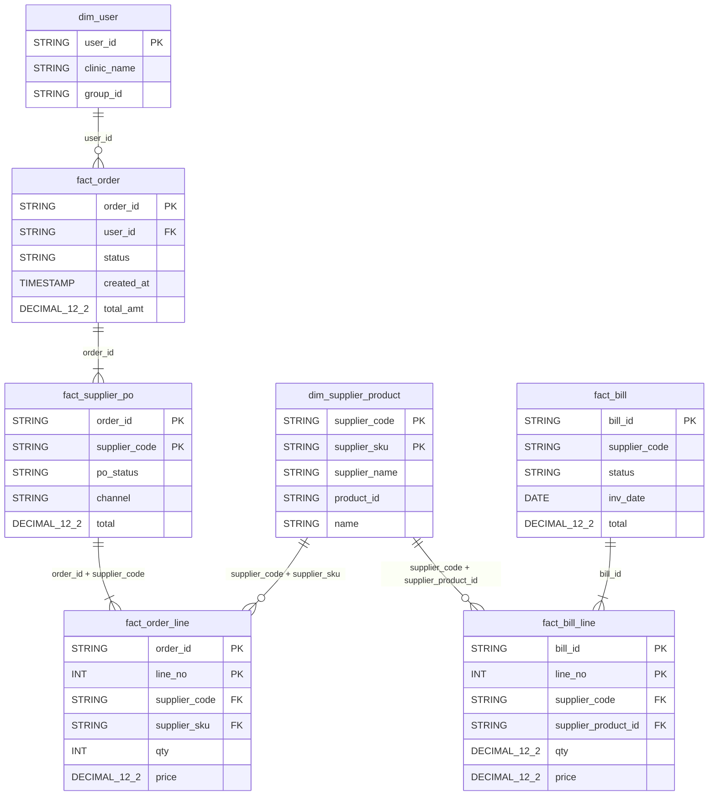

# Gold Layer Data Model

This document defines the gold layer: the tables, grains, keys and columns built on the silver layer to answer the business questions on orders, products and suppliers, bills and users.

**Rule for this version.** Every gold table and column comes from a silver table or column, under its silver name. Gold adds no surrogate keys, derived measures, calendar table, audit columns or placeholder rows. Totals, counts and monthly groupings are computed at query time from the silver values.

## Contents

- [1. Overview](#1-overview)
- [2. Business questions and where they are answered](#2-business-questions-and-where-they-are-answered)
- [3. ER diagram](#3-er-diagram)
- [4. Table inventory](#4-table-inventory)
- [5. Design principles](#5-design-principles)
- [6. Table specifications](#6-table-specifications)
- [7. Silver to gold mapping](#7-silver-to-gold-mapping)
- [8. Data quality checks](#8-data-quality-checks)
- [9. Assumptions and open items](#9-assumptions-and-open-items)
- [10. Build order and commit history](#10-build-order-and-commit-history)

## 1. Overview

Gold has **7 tables**: **2 dimensions** and **5 facts**, in two groups that share dimensions.

| Group | Facts | Grain | Dimensions |
|---|---|---|---|
| Orders | `fact_order`, `fact_supplier_po`, `fact_order_line` | Order, purchase order (order and supplier), order line | `dim_user`, `dim_supplier_product` |
| Bills | `fact_bill`, `fact_bill_line` | Bill, bill line | `dim_supplier_product` |

Keys are the silver natural keys: `user_id`, `supplier_code`, `supplier_sku`, `order_id`, `bill_id`. Lower-grain order facts reach the user and the order date through `fact_order` on `order_id`.

Four facts about the data shape the design:

- **Bills have no user and no order link.** Silver has no `user_id` on `BILLS`, and `po_reference` is free text. Bills cannot be split by user. `group_id` is the only bridge to the order side.
- **`ORDERS.total_amt` includes failed suppliers.** The value suppliers accepted is the sum of `ORDER_SUPPLIER_PO.total` where `po_status = 'SUCCESS'`.
- **Product and supplier references are incomplete.** Some order lines and many bill lines have no `SUPPLIER_PRODUCT` row. Gold keeps those fact rows. They simply have no matching dimension row.
- **Supplier and product are one dimension.** Both come from `SUPPLIER_PRODUCT`, so gold keeps them in one table, `dim_supplier_product`, at supplier and SKU grain. Only the line facts (`fact_order_line`, `fact_bill_line`) carry both keys and join to it. `fact_supplier_po` and `fact_bill` carry only `supplier_code` and do not join to it directly. See G11.

## 2. Business questions and where they are answered

| # | Area | Question | Tables | Calculation | Filter |
|---|---|---|---|---|---|
| 1a | Order analysis | How many orders are placed? | `fact_order` | Row count | None |
| 1b | Order analysis | What is the total order value? | `fact_order` | Sum of `total_amt` | None (see G1) |
| 1c | Order analysis | How do orders trend monthly? | `fact_order` | Row count and sum of `total_amt`, grouped by month of `created_at` | None |
| 2a | Product and supplier | Which products are ordered most? | `fact_order_line` + `dim_supplier_product` | Sum of `qty`, and distinct `order_id`, by `supplier_code` + `supplier_sku` | None. Failed POs still count as demand |
| 2b | Product and supplier | Which suppliers receive the highest order value? | `fact_supplier_po` (name via `fact_order_line` + `dim_supplier_product`) | Sum of `total` by `supplier_code`. Name taken once per code (see G11) | `po_status = 'SUCCESS'` |
| 3a | Bill analysis | What is the total billed amount? | `fact_bill` | Sum of `total` | None |
| 3b | Bill analysis | How many bills are pending, approved or disputed? | `fact_bill` | Row count by `status` | None (see G4) |
| 3c | Bill analysis | Which products and quantities are billed? | `fact_bill_line` + `dim_supplier_product` | Sum of `qty` and `price` by product | None |
| 4a | User analysis | Which users place the most orders? | `fact_order` + `dim_user` | Row count by `user_id`, descending | None |
| 4b | User analysis | What is the average order value per user? | `fact_order` + `dim_user` | Sum of `total_amt` divided by row count, by `user_id` | None |

Rules for using the facts correctly:

- Use each question's own table. Joining `fact_order` to a lower-grain fact repeats `total_amt` once per child row.
- To count orders from `fact_supplier_po` or `fact_order_line`, count distinct `order_id`.
- For a user label in 4a, use `clinic_name`. Names and emails are not in gold.
- Do not join `fact_supplier_po` or `fact_bill` to `dim_supplier_product` on `supplier_code` alone. That key is not unique in the dimension, so each `total` would repeat once per SKU of the supplier. Sum by `supplier_code` first, then look up the name once.

## 3. ER diagram

Foreign keys are informational, as in silver. Only keys and headline columns are drawn. Section 6 has every column. A colour-coded version with every column is in `gold_layer_er_diagram.png` (and `.svg`).

## 4. Table inventory

| Table | Type | Grain | Primary key | Built from (silver) |
|---|---|---|---|---|
| `dim_user` | Dimension | One row per user | `user_id` | `USERS` |
| `dim_supplier_product` | Dimension | One row per supplier and SKU | `supplier_code`, `supplier_sku` | `SUPPLIER_PRODUCT` |
| `fact_order` | Fact | One row per order | `order_id` | `ORDERS` |
| `fact_supplier_po` | Fact | One row per order and supplier | `order_id`, `supplier_code` | `ORDER_SUPPLIER_PO` |
| `fact_order_line` | Fact | One row per order line | `order_id`, `line_no` | `ORDER_LINE` |
| `fact_bill` | Fact | One row per bill | `bill_id` | `BILLS` |
| `fact_bill_line` | Fact | One row per bill line | `bill_id`, `line_no` | `BILL_LINE` |

## 5. Design principles

| # | Principle | How it is applied |
|---|---|---|
| 1 | **Silver columns only** | Each gold column is a silver column under its silver name. Nothing is invented or derived. |
| 2 | **Natural keys** | Gold joins on silver keys. There are no surrogate keys. |
| 3 | **Facts keep their keys** | A fact row whose user, supplier or product has no dimension row is kept as is. Nothing is dropped and no placeholder row is added. The share of such rows is recorded (check 5). |
| 4 | **No PII in gold** | Silver PII-direct and PII-contact columns are excluded: `email`, `fname`, `lname`, `phone_nos`, `street`, `city`, `state`, `zip_code`, `shipping_address`, `order_email`, `bill_to`, `ship_to`, `approval_info`. The business address fields `supplier_address` and `remit_to` are also left out because no question needs them. |
| 5 | **Test users are excluded** | Orders from users with `is_test = true` in silver are not loaded. Their purchase orders and lines follow the order. See G3. |
| 6 | **Latest version only** | Silver keeps one version per key, so gold does too. See G8. |
| 7 | **Silver types** | `DECIMAL(12,2)` for amounts, `DECIMAL(12,4)` for unit prices, UTC `TIMESTAMP`, `DATE` for calendar dates. |
| 8 | **Naming** | Table names are `snake_case` with a `dim_` or `fact_` prefix. Column names are unchanged from silver. |

## 6. Table specifications

Dimensions first, then facts. **Source** is the silver column. Every column keeps its silver name and type.

### 6.1 dim_supplier_product

- **Grain:** One row per supplier and SKU.
- **Source:** `SUPPLIER_PRODUCT`. One table for supplier and product, as in silver.
- **Primary key:** `supplier_code`, `supplier_sku`
- **Reached from:** `fact_order_line` and `fact_bill_line`. `fact_supplier_po` and `fact_bill` carry only `supplier_code` and do not join to it directly (G11).

| # | Column | Type | Key | Source |
|---|---|---|---|---|
| 1 | `supplier_code` | `STRING` | PK | `SUPPLIER_PRODUCT.supplier_code` |
| 2 | `supplier_sku` | `STRING` | PK | `SUPPLIER_PRODUCT.supplier_sku` |
| 3 | `supplier_name` | `STRING` |  | `SUPPLIER_PRODUCT.supplier_name` (nullable in silver) |
| 4 | `product_id` | `STRING` |  | `SUPPLIER_PRODUCT.product_id` |
| 5 | `name` | `STRING` |  | `SUPPLIER_PRODUCT.name` |

`supplier_name` repeats on every SKU row of a supplier. For supplier-level reports take it once per `supplier_code`. Order-side or bill-side keys with no row here keep their fact rows (principle 3). See G6.

### 6.2 dim_user

- **Grain:** One row per user (latest silver version).
- **Source:** `USERS`, test users removed, PII columns left out.
- **Primary key:** `user_id`

| # | Column | Type | Key | Source |
|---|---|---|---|---|
| 1 | `user_id` | `STRING` | PK | `USERS.user_id` |
| 2 | `clinic_name` | `STRING` |  | `USERS.clinic_name` (display label for user reports) |
| 3 | `group_id` | `STRING` |  | `USERS.group_id` |
| 4 | `subgroup_id` | `STRING` |  | `USERS.subgroup_id` |
| 5 | `user_type` | `ARRAY<STRING>` |  | `USERS.user_type` |
| 6 | `referral_type` | `STRING` |  | `USERS.referral_type` |
| 7 | `verification_status` | `STRING` |  | `USERS.verification_status` |
| 8 | `email_verified` | `BOOLEAN` |  | `USERS.email_verified` |
| 9 | `invite_accepted` | `BOOLEAN` |  | `USERS.invite_accepted` |
| 10 | `is_sourcing_enabled` | `BOOLEAN` |  | `USERS.is_sourcing_enabled` |
| 11 | `has_formulary` | `BOOLEAN` |  | `USERS.has_formulary` |
| 12 | `is_group_enabled` | `BOOLEAN` |  | `USERS.is_group_enabled` |
| 13 | `created_at` | `TIMESTAMP` |  | `USERS.created_at` |
| 14 | `last_login_at` | `TIMESTAMP` |  | `USERS.last_login_at` |

Left out: PII columns, `role_ids`, `department_ids`, `subgroup_ids`, notification flags, cart fields, `supplier_login_count`, other activity timestamps, `is_test` and all audit columns.

### 6.3 fact_order

- **Grain:** One row per order.
- **Source:** `ORDERS`, test-user orders removed.
- **Primary key:** `order_id`
- **Answers:** 1a, 1b, 1c, 4a, 4b.

| # | Column | Type | Key | Source |
|---|---|---|---|---|
| 1 | `order_id` | `STRING` | PK | `ORDERS.order_id` |
| 2 | `user_id` | `STRING` | FK | `ORDERS.user_id` |
| 3 | `group_id` | `STRING` |  | `ORDERS.group_id` |
| 4 | `status` | `STRING` |  | `ORDERS.status` |
| 5 | `created_at` | `TIMESTAMP` |  | `ORDERS.created_at` |
| 6 | `total_amt` | `DECIMAL(12,2)` |  | `ORDERS.total_amt` (includes the failed supplier) |
| 7 | `savings_total` | `DECIMAL(12,2)` |  | `ORDERS.savings_total` (formula unknown in source) |

Left out: `order_by` (G10), `shipping_address` (PII), `queued_at`, `processed_at` and the audit columns.

### 6.4 fact_supplier_po

- **Grain:** One row per order and supplier (one purchase order).
- **Source:** `ORDER_SUPPLIER_PO`, for orders kept in `fact_order`.
- **Primary key:** `order_id`, `supplier_code`
- **Answers:** 2b.

| # | Column | Type | Key | Source |
|---|---|---|---|---|
| 1 | `order_id` | `STRING` | PK, FK | `ORDER_SUPPLIER_PO.order_id` |
| 2 | `supplier_code` | `STRING` | PK | `ORDER_SUPPLIER_PO.supplier_code` |
| 3 | `po_num` | `STRING` |  | `ORDER_SUPPLIER_PO.po_num` |
| 4 | `sub_total` | `DECIMAL(12,2)` |  | `ORDER_SUPPLIER_PO.sub_total` |
| 5 | `tax` | `DECIMAL(12,2)` |  | `ORDER_SUPPLIER_PO.tax` |
| 6 | `shipping_cost` | `DECIMAL(12,2)` |  | `ORDER_SUPPLIER_PO.shipping_cost` |
| 7 | `discount` | `DECIMAL(12,2)` |  | `ORDER_SUPPLIER_PO.discount` |
| 8 | `total` | `DECIMAL(12,2)` |  | `ORDER_SUPPLIER_PO.total` |
| 9 | `shipping_method` | `STRING` |  | `ORDER_SUPPLIER_PO.shipping_method` |
| 10 | `payment_method` | `STRING` |  | `ORDER_SUPPLIER_PO.payment_method` |
| 11 | `supplier_order_id` | `STRING` |  | `ORDER_SUPPLIER_PO.supplier_order_id` |
| 12 | `po_status` | `STRING` |  | `ORDER_SUPPLIER_PO.po_status` (`SUCCESS` or `ERROR`) |
| 13 | `channel` | `STRING` |  | `ORDER_SUPPLIER_PO.channel` (`web`, `email`, `direct` or null) |

Left out: `order_email` (PII) and the email event fields (`email_delivery_status`, `event`, `event_processed`, `sg_message_id`, `sg_event_id`).

### 6.5 fact_order_line

- **Grain:** One row per order line.
- **Source:** `ORDER_LINE`, for orders kept in `fact_order`.
- **Primary key:** `order_id`, `line_no`
- **Answers:** 2a.

| # | Column | Type | Key | Source |
|---|---|---|---|---|
| 1 | `order_id` | `STRING` | PK, FK | `ORDER_LINE.order_id` |
| 2 | `line_no` | `INT` | PK | `ORDER_LINE.line_no` |
| 3 | `supplier_code` | `STRING` | FK | `ORDER_LINE.supplier_code` |
| 4 | `supplier_sku` | `STRING` | FK | `ORDER_LINE.supplier_sku` |
| 5 | `qty` | `INT` |  | `ORDER_LINE.qty` |
| 6 | `unit_price` | `DECIMAL(12,4)` |  | `ORDER_LINE.unit_price` |
| 7 | `price` | `DECIMAL(12,2)` |  | `ORDER_LINE.price` (assumed line total, G7) |
| 8 | `is_backorder` | `BOOLEAN` |  | `ORDER_LINE.is_backorder` |
| 9 | `account_department` | `STRING` |  | `ORDER_LINE.account_department` |
| 10 | `account_location_id` | `STRING` |  | `ORDER_LINE.account_location_id` |
| 11 | `account_expense_code` | `STRING` |  | `ORDER_LINE.account_expense_code` |

Left out: `lowest_price_qty`, `lowest_price_supplier_code`, `lowest_price_sku`, `lowest_price`. No question needs them.

### 6.6 fact_bill

- **Grain:** One row per bill (latest version).
- **Source:** `BILLS`.
- **Primary key:** `bill_id`
- **Answers:** 3a, 3b.

| # | Column | Type | Key | Source |
|---|---|---|---|---|
| 1 | `bill_id` | `STRING` | PK | `BILLS.bill_id` |
| 2 | `supplier_code` | `STRING` |  | `BILLS.supplier_code` |
| 3 | `supplier_name` | `STRING` |  | `BILLS.supplier_name` (as printed) |
| 4 | `status` | `STRING` |  | `BILLS.status` |
| 5 | `inv_num` | `STRING` |  | `BILLS.inv_num` |
| 6 | `inv_type` | `STRING` |  | `BILLS.inv_type` |
| 7 | `invoice_category` | `STRING` |  | `BILLS.invoice_category` |
| 8 | `inv_date` | `DATE` |  | `BILLS.inv_date` |
| 9 | `due_date` | `DATE` |  | `BILLS.due_date` |
| 10 | `is_due_date_defaulted` | `BOOLEAN` |  | `BILLS.is_due_date_defaulted` |
| 11 | `group_id` | `STRING` |  | `BILLS.group_id` |
| 12 | `sub_total` | `DECIMAL(12,2)` |  | `BILLS.sub_total` |
| 13 | `shipping` | `DECIMAL(12,2)` |  | `BILLS.shipping` |
| 14 | `taxes` | `DECIMAL(12,2)` |  | `BILLS.taxes` |
| 15 | `discount_amount` | `DECIMAL(12,2)` |  | `BILLS.discount_amount` |
| 16 | `total` | `DECIMAL(12,2)` |  | `BILLS.total` |
| 17 | `paid_amount` | `DECIMAL(12,2)` |  | `BILLS.paid_amount` |

Left out: PII and address text (`bill_to`, `ship_to`, `supplier_address`, `remit_to`, `approval_info`), workflow and file fields (`po_reference`, `customer_num`, `inbox_id`, `inv_source`, `file_name`, `original_filename`, `page_from`, `page_to`, `account_id`, `approval_condition_is_and`, `invoice_workflow_active`), `created_at`, `updated_at` and the audit columns.

### 6.7 fact_bill_line

- **Grain:** One row per bill line.
- **Source:** `BILL_LINE`.
- **Primary key:** `bill_id`, `line_no`
- **Answers:** 3c.

| # | Column | Type | Key | Source |
|---|---|---|---|---|
| 1 | `bill_id` | `STRING` | PK, FK | `BILL_LINE.bill_id` |
| 2 | `line_no` | `INT` | PK | `BILL_LINE.line_no` |
| 3 | `supplier_code` | `STRING` | FK | `BILL_LINE.supplier_code` |
| 4 | `supplier_product_id` | `STRING` | FK | `BILL_LINE.supplier_product_id` (as printed, matches `dim_supplier_product.supplier_sku`) |
| 5 | `name` | `STRING` |  | `BILL_LINE.name` (as printed) |
| 6 | `qty` | `DECIMAL(12,2)` |  | `BILL_LINE.qty` |
| 7 | `unit_price` | `DECIMAL(12,4)` |  | `BILL_LINE.unit_price` |
| 8 | `price` | `DECIMAL(12,2)` |  | `BILL_LINE.price` (assumed line total, G7) |

## 7. Silver to gold mapping

| Silver table | Gold table | Notes |
|---|---|---|
| `USERS` | `dim_user` | PII, role and department arrays, and activity fields left out. |
| `USER_ITEM` | Not used | Cart and price-comparison data. No business question needs it. |
| `SUPPLIER_PRODUCT` | `dim_supplier_product` | One dimension for supplier and product. |
| `ORDERS` | `fact_order` | Test users removed. |
| `ORDER_SUPPLIER_PO` | `fact_supplier_po` | Email event fields left out. |
| `ORDER_LINE` | `fact_order_line` | Lowest-price columns left out. |
| `BILLS` | `fact_bill` | PII and workflow fields left out. |
| `BILL_LINE` | `fact_bill_line` | |

## 8. Data quality checks

| # | Check | Applies to |
|---|---|---|
| 1 | Primary key is unique and not null. | All tables |
| 2 | Row counts match silver. The only allowed gap is rows removed for test users, and that count is logged. | All tables |
| 3 | Sum of `total_amt` equals the sum of `ORDERS.total_amt` after the test-user removal. Same for `BILLS.total` and `fact_bill`. | `fact_order`, `fact_bill` |
| 4 | Every `fact_supplier_po` and `fact_order_line` row has a `fact_order` row. Every `fact_bill_line` has a `fact_bill` row. | Child facts |
| 5 | Share of fact rows with no dimension row is recorded for `user_id`, `supplier_code` and product. | All facts |
| 6 | Sum of `total` per order in `fact_supplier_po` is compared with `total_amt`, and the difference is reported. | `fact_order`, `fact_supplier_po` |
| 7 | Silver's bill reconciliation difference (`total - (sub_total + shipping + taxes - discount_amount)`) is reported for bills outside tolerance. | `fact_bill` |
| 8 | No column from silver classes PII-direct or PII-contact exists in any gold table. | All tables |

## 9. Assumptions and open items

| # | Item | Current assumption 
|---|---|---|---|
| G1 | Meaning of "total order value" | `fact_order.total_amt` as placed, which includes failed suppliers. Accepted value is the sum of `fact_supplier_po.total` where `po_status = 'SUCCESS'`.
| G2 | Supplier order value | Counts only `po_status = 'SUCCESS'`. A failed PO did not reach the supplier. 
| G3 | Test users | Orders from users with `is_test = true` are excluded.
| G4 | Bill status values | The values behind pending, approved and disputed are not visible in silver. Counts run on the raw `status` text until the distinct values are known. 
| G5 | Time zone | Months come from UTC timestamps. If reporting uses a local zone, convert before grouping.
| G6 | Supplier codes across orders and bills | Bill codes are assumed to equal order-side and product codes. If the match rate is low, a supplier code mapping is needed. 
| G7 | `price` on lines | Line total (silver open item 4). Bill line product matches may also drop because of size suffixes (silver open item 9). 
| G8 | History | Latest version only, as in silver. Status changes over time cannot be analyzed. 
| G9 | Orders and bills | No user or order link between them. `group_id` is the only bridge. 
| G10 | `ORDERS.order_by` | Not in gold for now.
| G11 | Supplier names on PO and bill totals | `fact_supplier_po` and `fact_bill` have no direct link to `dim_supplier_product`. Group PO totals by `supplier_code`. The name comes from `fact_order_line` + `dim_supplier_product` and is missing when a line has no product row. Bills use their own `supplier_name`.