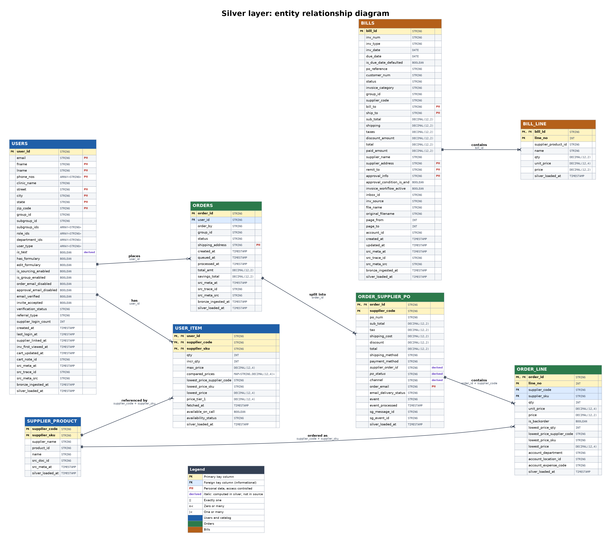

# Silver Layer Data Model

This document defines the silver layer: its tables, columns, keys, relationships, derived fields, cleaning rules, PII handling and data quality checks. It is the reference for anyone building or using silver tables.

**Scope.** Which fields are in silver, which are not, and which are new, and the steps that build silver from bronze (sections 15 to 17).

## Contents

- [1. Overview](#1-overview)
- [2. ER diagram](#2-er-diagram)
- [3. Table inventory](#3-table-inventory)
- [4. Design principles](#4-design-principles)
- [5. Conventions](#5-conventions)
- [6. Audit and lineage columns](#6-audit-and-lineage-columns)
- [7. Table specifications](#7-table-specifications)
- [8. Relationships](#8-relationships)
- [9. Derived columns](#9-derived-columns)
- [10. Source field decisions](#10-source-field-decisions)
- [11. Cleaning rules](#11-cleaning-rules)
- [12. PII and data protection](#12-pii-and-data-protection)
- [13. Data quality checks](#13-data-quality-checks)
- [14. Assumptions and open items](#14-assumptions-and-open-items)
- [15. Build steps: bronze to silver](#15-build-steps-bronze-to-silver)
- [16. Run-level checks and monitoring](#16-run-level-checks-and-monitoring)
- [17. Maintenance and reprocessing](#17-maintenance-and-reprocessing)

## 1. Overview

Bronze keeps every source document exactly as received, stored in Delta, with no changes. Silver is the cleaned, typed and de-duplicated layer built from it. Every silver row can be traced back to its bronze document and version. The steps that turn bronze into silver (type conversion, null handling, cleaning, validation and loading) are in [section 15](#15-build-steps-bronze-to-silver).

Silver has **8 tables** and **8 relationships**, grouped in three domains:

| Domain | Tables | What it holds |
|---|---|---|
| Users and catalog | `USERS`, `USER_ITEM`, `SUPPLIER_PRODUCT` | Users, their cart and price-comparison items, and the supplier product reference. |
| Orders | `ORDERS`, `ORDER_SUPPLIER_PO`, `ORDER_LINE` | Orders, the purchase order per supplier, and the order lines. |
| Bills | `BILLS`, `BILL_LINE` | Supplier invoices and their lines. |

`SUPPLIER_PRODUCT` is the shared product reference: user items, order lines and bill lines all point to it. There is no direct link between orders and bills.

## 2. ER diagram

Click the image to open it at full size.

How to read it:

- Yellow rows are primary key columns, blue rows are foreign key columns that are not part of the primary key.
- **PII** marks personal data. *Italic* names are derived in silver.
- Line ends use crow's foot notation. `||` is exactly one, `o<` is zero or many, `|<` is one or many. The line label gives the relationship name and the join columns.
- Foreign keys are informational. Delta does not enforce them (see [section 13](#13-data-quality-checks)).

```mermaid
erDiagram
    USERS ||--o{ USER_ITEM : "has"
    USERS ||--o{ ORDERS : "places"
    SUPPLIER_PRODUCT ||--o{ USER_ITEM : "referenced by"
    SUPPLIER_PRODUCT ||--o{ ORDER_LINE : "ordered as"
    SUPPLIER_PRODUCT ||--o{ BILL_LINE : "billed as"
    ORDERS ||--|{ ORDER_SUPPLIER_PO : "split into"
    ORDER_SUPPLIER_PO ||--|{ ORDER_LINE : "contains"
    BILLS ||--|{ BILL_LINE : "contains"

    USERS {
        STRING user_id PK
        STRING email "PII"
        STRING fname "PII"
        STRING lname "PII"
        ARRAY_STRING phone_nos "PII"
        STRING clinic_name
        STRING street "PII"
        STRING city "PII"
        STRING state "PII"
        STRING zip_code "PII"
        STRING group_id
        STRING subgroup_id
        ARRAY_STRING subgroup_ids
        ARRAY_STRING role_ids
        ARRAY_STRING department_ids
        ARRAY_STRING user_type
        BOOLEAN is_test "derived"
        BOOLEAN has_formulary
        BOOLEAN edit_formulary
        BOOLEAN is_sourcing_enabled
        BOOLEAN is_group_enabled
        BOOLEAN order_email_disabled
        BOOLEAN approval_email_disabled
        BOOLEAN email_verified
        BOOLEAN invite_accepted
        STRING verification_status
        STRING referral_type
        INT supplier_login_count
        TIMESTAMP created_at
        TIMESTAMP last_login_at
        TIMESTAMP supplier_linked_at
        TIMESTAMP inv_first_viewed_at
        TIMESTAMP cart_updated_at
        STRING cart_note_id
        TIMESTAMP src_meta_at
        STRING src_trace_id
        STRING src_meta_src
        TIMESTAMP bronze_ingested_at
        TIMESTAMP silver_loaded_at
    }
    USER_ITEM {
        STRING user_id PK, FK
        STRING supplier_code PK, FK
        STRING supplier_sku PK, FK
        INT qty
        INT incr_qty
        DECIMAL_12_4 max_price
        MAP_STRING_DECIMAL_12_4 compared_prices
        STRING lowest_price_supplier_code
        STRING lowest_price_sku
        DECIMAL_12_4 lowest_price
        DECIMAL_12_4 price_tier_1
        TIMESTAMP fetched_at
        BOOLEAN available_on_call
        STRING availability_status
        TIMESTAMP silver_loaded_at
    }
    SUPPLIER_PRODUCT {
        STRING supplier_code PK
        STRING supplier_sku PK
        STRING supplier_name
        STRING product_id
        STRING name
        STRING src_doc_id
        TIMESTAMP src_meta_at
        TIMESTAMP silver_loaded_at
    }
    ORDERS {
        STRING order_id PK
        STRING user_id FK
        STRING order_by
        STRING group_id
        STRING status
        STRING shipping_address "PII"
        TIMESTAMP created_at
        TIMESTAMP queued_at
        TIMESTAMP processed_at
        DECIMAL_12_2 total_amt
        DECIMAL_12_2 savings_total
        TIMESTAMP src_meta_at
        STRING src_trace_id
        STRING src_meta_src
        TIMESTAMP bronze_ingested_at
        TIMESTAMP silver_loaded_at
    }
    ORDER_SUPPLIER_PO {
        STRING order_id PK, FK
        STRING supplier_code PK
        STRING po_num
        DECIMAL_12_2 sub_total
        DECIMAL_12_2 tax
        DECIMAL_12_2 shipping_cost
        DECIMAL_12_2 discount
        DECIMAL_12_2 total
        STRING shipping_method
        STRING payment_method
        STRING supplier_order_id "derived"
        STRING po_status "derived"
        STRING channel "derived"
        STRING order_email "PII"
        STRING email_delivery_status
        STRING event
        TIMESTAMP event_processed
        STRING sg_message_id
        STRING sg_event_id
        TIMESTAMP silver_loaded_at
    }
    ORDER_LINE {
        STRING order_id PK, FK
        INT line_no PK
        STRING supplier_code FK
        STRING supplier_sku FK
        INT qty
        DECIMAL_12_4 unit_price
        DECIMAL_12_2 price
        BOOLEAN is_backorder
        INT lowest_price_qty
        STRING lowest_price_supplier_code
        STRING lowest_price_sku
        DECIMAL_12_4 lowest_price
        STRING account_department
        STRING account_location_id
        STRING account_expense_code
        TIMESTAMP silver_loaded_at
    }
    BILLS {
        STRING bill_id PK
        STRING inv_num
        STRING inv_type
        DATE inv_date
        DATE due_date
        BOOLEAN is_due_date_defaulted
        STRING po_reference
        STRING customer_num
        STRING status
        STRING invoice_category
        STRING group_id
        STRING supplier_code
        STRING bill_to "PII"
        STRING ship_to "PII"
        DECIMAL_12_2 sub_total
        DECIMAL_12_2 shipping
        DECIMAL_12_2 taxes
        DECIMAL_12_2 discount_amount
        DECIMAL_12_2 total
        DECIMAL_12_2 paid_amount
        STRING supplier_name
        STRING supplier_address "PII"
        STRING remit_to "PII"
        STRING approval_info "PII"
        BOOLEAN approval_condition_is_and
        BOOLEAN invoice_workflow_active
        STRING inbox_id
        STRING inv_source
        STRING file_name
        STRING original_filename
        INT page_from
        INT page_to
        STRING account_id
        TIMESTAMP created_at
        TIMESTAMP updated_at
        TIMESTAMP src_meta_at
        STRING src_trace_id
        STRING src_meta_src
        TIMESTAMP bronze_ingested_at
        TIMESTAMP silver_loaded_at
    }
    BILL_LINE {
        STRING bill_id PK, FK
        INT line_no PK
        STRING supplier_code FK
        STRING supplier_product_id FK
        STRING name
        DECIMAL_12_2 qty
        DECIMAL_12_4 unit_price
        DECIMAL_12_2 price
        TIMESTAMP silver_loaded_at
    }
```

Mermaid source (renders directly in GitHub and most markdown viewers)

Mermaid type names cannot contain commas or angle brackets, so `DECIMAL(12,2)` is written `DECIMAL_12_2`, `ARRAY<STRING>` is `ARRAY_STRING`, and so on. The tables in section 7 use the real Delta types.

## 3. Table inventory

| Table | Domain | Grain | Primary key | Parent | Columns |
|---|---|---|---|---|---|
| `USERS` | Users and catalog | One row per user (latest version). | `user_id` | - | 39 |
| `USER_ITEM` | Users and catalog | One row per user and supplier item: cart items plus price-comparison and price-cache entries. | `user_id`, `supplier_code`, `supplier_sku` | `USERS` | 15 |
| `SUPPLIER_PRODUCT` | Users and catalog | One row per supplier and SKU. | `supplier_code`, `supplier_sku` | - | 8 |
| `ORDERS` | Orders | One row per order (latest version). | `order_id` | `USERS` | 16 |
| `ORDER_SUPPLIER_PO` | Orders | One row per order and supplier (one purchase order). | `order_id`, `supplier_code` | `ORDERS` | 20 |
| `ORDER_LINE` | Orders | One row per order line. `line_no` is the 1-based array position. | `order_id`, `line_no` | `ORDER_SUPPLIER_PO` | 16 |
| `BILLS` | Bills | One row per bill (latest version). | `bill_id` | - | 40 |
| `BILL_LINE` | Bills | One row per invoice line. `line_no` is the 1-based array position. | `bill_id`, `line_no` | `BILLS` | 9 |

Total: 163 columns across 8 tables, including audit columns.

## 4. Design principles

| # | Principle | How it is applied |
|---|---|---|
| 1 | **One document id, one key** | Every silver table carries the bronze document id inside its key (`user_id`, `order_id`, `bill_id`). That key is the trace-back link, so there is no separate document id column. The one exception is `SUPPLIER_PRODUCT`, whose key holds no document id. |
| 2 | **Audit once per document** | Version and ingestion audit columns sit on the top-level tables (`USERS`, `ORDERS`, `BILLS`). Child rows are always written with their parent version and inherit it through the key. Every table keeps `silver_loaded_at`. |
| 3 | **No copied columns** | A child table does not repeat a parent column unless the column is part of one of its own foreign keys. The one case is `BILL_LINE.supplier_code`, copied from `BILLS` so that bill lines can reference `SUPPLIER_PRODUCT`. |
| 4 | **Cleaned value only** | Where a raw and a cleaned value would both exist, silver keeps the cleaned one. The raw value stays in bronze. |
| 5 | **Store business rules, not arithmetic** | A derived column is stored only when it encodes a rule every consumer must apply the same way (`is_test`, `po_status`, `channel`, `supplier_order_id`). Plain same-row arithmetic or a copy of another column is not stored. |
| 6 | **Load-only fields stay in bronze** | Fields used only to pick the latest version, such as the bill `tlm` field, are not copied to silver. |
| 7 | **Exact types** | `DECIMAL(12,2)` for amounts, `DECIMAL(12,4)` for unit prices, `TIMESTAMP` in UTC, `DATE` for calendar dates, `ARRAY` and `MAP` for repeated values. |
| 8 | **Keys are documentation in Delta** | Key constraints are informational at best, so uniqueness and orphan checks are defined as data quality checks. |
| 9 | **PII is tagged and controlled** | Personal data stays raw in silver, is classified per column, and is protected by access control. See [section 12](#12-pii-and-data-protection). |
| 10 | **Secrets never enter silver** | Credentials stay in bronze only. |

## 5. Conventions

| Topic | Convention |
|---|---|
| Naming | `snake_case`. Ids end in `_id`. Timestamps end in `_at`. Audit and lineage columns start with `src_` or `bronze_` or `silver_`. |
| Identifiers | Bronze `_id.$oid` is flattened to a plain string and used as the table key. |
| Latest version | One row per document id, chosen by the bronze `_meta.at`. For bills, ties are broken by the bronze `tlm` field. |
| Timestamps | The three source formats (`$date` milliseconds, epoch milliseconds, ISO text) all become UTC `TIMESTAMP`. Epoch seconds are converted. |
| Dates | Calendar dates (`inv_date`, `due_date`) are `DATE`. |
| Money | Amounts are `DECIMAL(12,2)`. Unit prices are `DECIMAL(12,4)`. Strings and floats are cast. |
| Text encoding | UTF-8 is forced to repair the `ÔøΩ` replacement-character error. |
| Empty values | An empty `{}` or `""` becomes null where it means no value. A missing `is_backorder` becomes false. |
| Arrays and maps | Repeated values use `ARRAY<STRING>`. Per-supplier price lists use `MAP<STRING,DECIMAL(12,4)>`. |
| Child row position | `line_no` is the 1-based position in the source array. |
| Composite source keys | A source key such as `SUP:SKU` is split on the first colon into `supplier_code` and `supplier_sku`. |

## 6. Audit and lineage columns

| Column | Type | On tables | Source and purpose |
|---|---|---|---|
| `silver_loaded_at` | `TIMESTAMP`, required | All tables | When the row was written to silver. |
| `src_meta_at` | `TIMESTAMP` | `USERS`, `ORDERS`, `BILLS`, `SUPPLIER_PRODUCT` | Bronze `_meta.at`. The document version the row came from. Used to pick the latest version. |
| `src_trace_id` | `STRING` | `USERS`, `ORDERS`, `BILLS` | Bronze `_meta.traceId`. Link to the service request that wrote the change. |
| `src_meta_src` | `STRING` | `USERS`, `ORDERS`, `BILLS` | Bronze `_meta.src`. The service that wrote the change. |
| `bronze_ingested_at` | `TIMESTAMP` | `USERS`, `ORDERS`, `BILLS` | When bronze received the record. |
| `src_doc_id` | `STRING`, required | `SUPPLIER_PRODUCT` only | Bronze document the row came from. |

**Trace-back rule.** A silver row is traced to bronze through its key:

- Top-level tables (`USERS`, `ORDERS`, `BILLS`): the primary key is the bronze `_id`.
- Child tables (`USER_ITEM`, `ORDER_SUPPLIER_PO`, `ORDER_LINE`, `BILL_LINE`): the parent id in the key is the bronze `_id`, and the child version is the parent row's `src_meta_at`.
- `SUPPLIER_PRODUCT`: the stored `src_doc_id` and `src_meta_at`.

The bronze `_meta.by` field is an email address (PII) and is not copied. It can be recovered from bronze through `src_trace_id`.

## 7. Table specifications

Column tables list every silver column in order. **Class** shows the PII classification (see [section 12](#12-pii-and-data-protection)). **Required** means not null.

### 7.1 USERS

- **Domain:** Users and catalog
- **Grain:** One row per user (latest version).
- **Source:** Bronze users document.
- **Primary key:** `user_id`

| # | Column | Type | Key | Required | Class | Description |
|---|---|---|---|---|---|---|
| 1 | `user_id` | `STRING` | PK | Yes |  | Bronze `_id` flattened to text. Also the bronze document id. |
| 2 | `email` | `STRING` |  |  | PII-direct | Join and audit value. |
| 3 | `fname` | `STRING` |  |  | PII-direct |  |
| 4 | `lname` | `STRING` |  |  | PII-direct |  |
| 5 | `phone_nos` | `ARRAY<STRING>` |  |  | PII-direct | Union of `phone_no` and `phone_nos`, de-duplicated. |
| 6 | `clinic_name` | `STRING` |  |  |  |  |
| 7 | `street` | `STRING` |  |  | PII-contact |  |
| 8 | `city` | `STRING` |  |  | PII-contact |  |
| 9 | `state` | `STRING` |  |  | PII-contact |  |
| 10 | `zip_code` | `STRING` |  |  | PII-contact | Stored as text. |
| 11 | `group_id` | `STRING` |  |  |  | Link to the group. There is no group table in silver. |
| 12 | `subgroup_id` | `STRING` |  |  |  | Primary subgroup (assumed). |
| 13 | `subgroup_ids` | `ARRAY<STRING>` |  |  |  |  |
| 14 | `role_ids` | `ARRAY<STRING>` |  |  |  | Ids only. Names need master collections. |
| 15 | `department_ids` | `ARRAY<STRING>` |  |  |  | Ids only. Names need master collections. |
| 16 | `user_type` | `ARRAY<STRING>` |  |  |  | Source for `is_test`. |
| 17 | `is_test` | `BOOLEAN` |  | Yes |  | **Derived.** True if `user_type` contains `test`. |
| 18 | `has_formulary` | `BOOLEAN` |  |  |  | Feature flag. |
| 19 | `edit_formulary` | `BOOLEAN` |  |  |  | Feature flag. |
| 20 | `is_sourcing_enabled` | `BOOLEAN` |  |  |  | Feature flag. |
| 21 | `is_group_enabled` | `BOOLEAN` |  |  |  | Feature flag. |
| 22 | `order_email_disabled` | `BOOLEAN` |  |  |  | Notification preference. |
| 23 | `approval_email_disabled` | `BOOLEAN` |  |  |  | Notification preference. |
| 24 | `email_verified` | `BOOLEAN` |  |  |  | Onboarding state. |
| 25 | `invite_accepted` | `BOOLEAN` |  |  |  | Onboarding state. |
| 26 | `verification_status` | `STRING` |  |  |  |  |
| 27 | `referral_type` | `STRING` |  |  |  | Acquisition channel. |
| 28 | `supplier_login_count` | `INT` |  |  |  | Possible engagement signal. Meaning assumed. |
| 29 | `created_at` | `TIMESTAMP` |  |  |  | UTC. |
| 30 | `last_login_at` | `TIMESTAMP` |  |  |  | UTC. |
| 31 | `supplier_linked_at` | `TIMESTAMP` |  |  |  | UTC. |
| 32 | `inv_first_viewed_at` | `TIMESTAMP` |  |  |  | UTC. Product adoption signal. |
| 33 | `cart_updated_at` | `TIMESTAMP` |  |  |  | UTC. Converted from `cart_updated_millis`. |
| 34 | `cart_note_id` | `STRING` |  |  |  |  |
| 35 | `src_meta_at` | `TIMESTAMP` |  |  |  | Audit. Bronze `_meta.at`: the document version this row came from. |
| 36 | `src_trace_id` | `STRING` |  |  |  | Audit. Bronze `_meta.traceId`. |
| 37 | `src_meta_src` | `STRING` |  |  |  | Audit. Bronze `_meta.src`: the service that wrote the change. |
| 38 | `bronze_ingested_at` | `TIMESTAMP` |  |  |  | Audit. When bronze received the record. |
| 39 | `silver_loaded_at` | `TIMESTAMP` |  | Yes |  | Audit. When this silver row was written. |

Notes: `group_id`, `role_ids` and `department_ids` hold ids only because the master collections are not part of silver. `order_email_disabled`, `approval_email_disabled` and `supplier_login_count` are kept on the assumption that they are useful (see [section 14](#14-assumptions-and-open-items)).

### 7.2 USER_ITEM

- **Domain:** Users and catalog
- **Grain:** One row per user and supplier item: cart items plus price-comparison and price-cache entries.
- **Source:** Bronze users document. The source key `SUP:SKU` is split on the first colon.
- **Primary key:** `user_id`, `supplier_code`, `supplier_sku`
- **Parent:** `USERS`

| # | Column | Type | Key | Required | Class | Description |
|---|---|---|---|---|---|---|
| 1 | `user_id` | `STRING` | PK, FK | Yes |  |  |
| 2 | `supplier_code` | `STRING` | PK, FK | Yes |  | Part of the composite FK to SUPPLIER_PRODUCT. |
| 3 | `supplier_sku` | `STRING` | PK, FK | Yes |  | Part of the composite FK to SUPPLIER_PRODUCT. |
| 4 | `qty` | `INT` |  |  |  | Cart quantity. Null means the item is not in the cart (price cache or comparison only). |
| 5 | `incr_qty` | `INT` |  |  |  |  |
| 6 | `max_price` | `DECIMAL(12,4)` |  |  |  |  |
| 7 | `compared_prices` | `MAP<STRING,DECIMAL(12,4)>` |  |  |  | Per-supplier prices keyed by the source `SUP:SKU` key. Strings cast to numeric. |
| 8 | `lowest_price_supplier_code` | `STRING` |  |  |  | Empty `{}` in the source becomes null. |
| 9 | `lowest_price_sku` | `STRING` |  |  |  | Empty `{}` in the source becomes null. |
| 10 | `lowest_price` | `DECIMAL(12,4)` |  |  |  | Empty `{}` in the source becomes null. |
| 11 | `price_tier_1` | `DECIMAL(12,4)` |  |  |  |  |
| 12 | `fetched_at` | `TIMESTAMP` |  |  |  | Epoch ms to UTC. Shows price freshness. |
| 13 | `available_on_call` | `BOOLEAN` |  |  |  |  |
| 14 | `availability_status` | `STRING` |  |  |  |  |
| 15 | `silver_loaded_at` | `TIMESTAMP` |  | Yes |  | Audit. When this silver row was written. |

Notes: a row exists for every item key found in the cart, the price comparison or the price cache. An item is in the cart when `qty` is not null. Comparison keys that are not in the cart have a null `qty`. The composite foreign key to `SUPPLIER_PRODUCT` is informational, and some items may have no product row.

### 7.3 SUPPLIER_PRODUCT

- **Domain:** Users and catalog
- **Grain:** One row per supplier and SKU.
- **Source:** To be confirmed (see open items). Its key holds no document id, so it carries its own lineage.
- **Primary key:** `supplier_code`, `supplier_sku`

| # | Column | Type | Key | Required | Class | Description |
|---|---|---|---|---|---|---|
| 1 | `supplier_code` | `STRING` | PK | Yes |  |  |
| 2 | `supplier_sku` | `STRING` | PK | Yes |  |  |
| 3 | `supplier_name` | `STRING` |  |  |  | Nullable until a supplier master exists. |
| 4 | `product_id` | `STRING` |  |  |  |  |
| 5 | `name` | `STRING` |  |  |  | Forced to UTF-8 to repair the `ÔøΩ` encoding error. |
| 6 | `src_doc_id` | `STRING` |  | Yes |  | Audit. Bronze document the winning row came from. |
| 7 | `src_meta_at` | `TIMESTAMP` |  |  |  | Audit. Version of that document. |
| 8 | `silver_loaded_at` | `TIMESTAMP` |  | Yes |  | Audit. When this silver row was written. |

Notes: the source collection is to be confirmed (see [section 14](#14-assumptions-and-open-items)). `image_url` is excluded.

### 7.4 ORDERS

- **Domain:** Orders
- **Grain:** One row per order (latest version).
- **Source:** Bronze orders document.
- **Primary key:** `order_id`
- **Parent:** `USERS`

| # | Column | Type | Key | Required | Class | Description |
|---|---|---|---|---|---|---|
| 1 | `order_id` | `STRING` | PK | Yes |  | Bronze `_id` flattened. Also the bronze document id. |
| 2 | `user_id` | `STRING` | FK |  |  | References USERS. |
| 3 | `order_by` | `STRING` |  |  |  | Plain column. No FK until what it references is confirmed. |
| 4 | `group_id` | `STRING` |  |  |  | Snapshot at order time. |
| 5 | `status` | `STRING` |  |  |  |  |
| 6 | `shipping_address` | `STRING` |  |  | PII-contact | Address lines joined into one text, in order. |
| 7 | `created_at` | `TIMESTAMP` |  |  |  |  |
| 8 | `queued_at` | `TIMESTAMP` |  |  |  |  |
| 9 | `processed_at` | `TIMESTAMP` |  |  |  |  |
| 10 | `total_amt` | `DECIMAL(12,2)` |  |  |  | Includes the failed supplier. Kept for reconciliation. |
| 11 | `savings_total` | `DECIMAL(12,2)` |  |  |  | Formula unknown, so not derivable. |
| 12 | `src_meta_at` | `TIMESTAMP` |  |  |  | Audit. Bronze `_meta.at`: the document version this row came from. |
| 13 | `src_trace_id` | `STRING` |  |  |  | Audit. Bronze `_meta.traceId`. |
| 14 | `src_meta_src` | `STRING` |  |  |  | Audit. Bronze `_meta.src`: the service that wrote the change. |
| 15 | `bronze_ingested_at` | `TIMESTAMP` |  |  |  | Audit. When bronze received the record. |
| 16 | `silver_loaded_at` | `TIMESTAMP` |  | Yes |  | Audit. When this silver row was written. |

Notes: `total_amt` includes the failed supplier, so it can differ from the sum of successful `ORDER_SUPPLIER_PO.total` values. Compare it with the PO totals for reconciliation.

### 7.5 ORDER_SUPPLIER_PO

- **Domain:** Orders
- **Grain:** One row per order and supplier (one purchase order).
- **Source:** The supplier map inside the bronze orders document.
- **Primary key:** `order_id`, `supplier_code`
- **Parent:** `ORDERS`

| # | Column | Type | Key | Required | Class | Description |
|---|---|---|---|---|---|---|
| 1 | `order_id` | `STRING` | PK, FK | Yes |  | References ORDERS. |
| 2 | `supplier_code` | `STRING` | PK | Yes |  | Map key from the source. |
| 3 | `po_num` | `STRING` |  |  |  |  |
| 4 | `sub_total` | `DECIMAL(12,2)` |  |  |  |  |
| 5 | `tax` | `DECIMAL(12,2)` |  |  |  |  |
| 6 | `shipping_cost` | `DECIMAL(12,2)` |  |  |  |  |
| 7 | `discount` | `DECIMAL(12,2)` |  |  |  | Stays null when null. |
| 8 | `total` | `DECIMAL(12,2)` |  |  |  | Source value. Kept for reconciliation. |
| 9 | `shipping_method` | `STRING` |  |  |  |  |
| 10 | `payment_method` | `STRING` |  |  |  |  |
| 11 | `supplier_order_id` | `STRING` |  |  |  | **Derived.** Real external id, or null for blank or free text. The raw value stays in bronze. |
| 12 | `po_status` | `STRING` |  | Yes |  | **Derived.** `SUCCESS` or `ERROR`, from the success and error supplier lists in bronze. |
| 13 | `channel` | `STRING` |  |  |  | **Derived.** `web`, `email` or `direct`. Inferred rule. Null if undecided. |
| 14 | `order_email` | `STRING` |  |  | PII-direct |  |
| 15 | `email_delivery_status` | `STRING` |  |  |  |  |
| 16 | `event` | `STRING` |  |  |  | Delivery event type. `event_name` is merged into it. |
| 17 | `event_processed` | `TIMESTAMP` |  |  |  | UTC. |
| 18 | `sg_message_id` | `STRING` |  |  |  | Trace to the email provider. |
| 19 | `sg_event_id` | `STRING` |  |  |  | Trace to the email provider. |
| 20 | `silver_loaded_at` | `TIMESTAMP` |  | Yes |  | Audit. When this silver row was written. |

Notes: `po_status`, `channel` and `supplier_order_id` are derived (see [section 9](#9-derived-columns)). A row exists for every supplier in the order, including suppliers whose order failed.

### 7.6 ORDER_LINE

- **Domain:** Orders
- **Grain:** One row per order line. `line_no` is the 1-based array position.
- **Source:** The order lines array inside the bronze orders document.
- **Primary key:** `order_id`, `line_no`
- **Parent:** `ORDER_SUPPLIER_PO`

| # | Column | Type | Key | Required | Class | Description |
|---|---|---|---|---|---|---|
| 1 | `order_id` | `STRING` | PK, FK | Yes |  | Part of the composite FK to ORDER_SUPPLIER_PO. |
| 2 | `line_no` | `INT` | PK | Yes |  |  |
| 3 | `supplier_code` | `STRING` | FK | Yes |  | Part of the composite FKs to ORDER_SUPPLIER_PO (with `order_id`) and SUPPLIER_PRODUCT (with `supplier_sku`). |
| 4 | `supplier_sku` | `STRING` | FK | Yes |  | Part of the composite FK to SUPPLIER_PRODUCT. |
| 5 | `qty` | `INT` |  |  |  | Same type as `lowest_price_qty`. |
| 6 | `unit_price` | `DECIMAL(12,4)` |  |  |  |  |
| 7 | `price` | `DECIMAL(12,2)` |  |  |  | Assumed line total. |
| 8 | `is_backorder` | `BOOLEAN` |  | Yes |  | Missing becomes false. |
| 9 | `lowest_price_qty` | `INT` |  |  |  | Same type as `qty`. |
| 10 | `lowest_price_supplier_code` | `STRING` |  |  |  | From the dynamic `SUP:SKU` key. |
| 11 | `lowest_price_sku` | `STRING` |  |  |  | From the dynamic `SUP:SKU` key. |
| 12 | `lowest_price` | `DECIMAL(12,4)` |  |  |  |  |
| 13 | `account_department` | `STRING` |  |  |  | Needed for spend analysis. |
| 14 | `account_location_id` | `STRING` |  |  |  | Needed for spend analysis. |
| 15 | `account_expense_code` | `STRING` |  |  |  | Needed for spend analysis. |
| 16 | `silver_loaded_at` | `TIMESTAMP` |  | Yes |  | Audit. When this silver row was written. |

Notes: `supplier_code` takes part in two composite keys: with `order_id` it points to `ORDER_SUPPLIER_PO`, and with `supplier_sku` it points to `SUPPLIER_PRODUCT`.

### 7.7 BILLS

- **Domain:** Bills
- **Grain:** One row per bill (latest version).
- **Source:** Bronze bills document.
- **Primary key:** `bill_id`

| # | Column | Type | Key | Required | Class | Description |
|---|---|---|---|---|---|---|
| 1 | `bill_id` | `STRING` | PK | Yes |  | Bronze `_id` flattened. Also the bronze document id. |
| 2 | `inv_num` | `STRING` |  |  |  |  |
| 3 | `inv_type` | `STRING` |  |  |  | `document_type` is dropped as a duplicate. |
| 4 | `inv_date` | `DATE` |  |  |  |  |
| 5 | `due_date` | `DATE` |  |  |  |  |
| 6 | `is_due_date_defaulted` | `BOOLEAN` |  |  |  | True when the due date is not on the invoice. |
| 7 | `po_reference` | `STRING` |  |  |  | From `po_num`, kept as printed. Not a reliable FK. |
| 8 | `customer_num` | `STRING` |  |  |  |  |
| 9 | `status` | `STRING` |  |  |  |  |
| 10 | `invoice_category` | `STRING` |  |  |  |  |
| 11 | `group_id` | `STRING` |  |  |  |  |
| 12 | `supplier_code` | `STRING` |  |  |  | Supplier code as on the bill. Copied to `BILL_LINE.supplier_code` for the product link. |
| 13 | `bill_to` | `STRING` |  |  | PII-contact | Free text kept raw. |
| 14 | `ship_to` | `STRING` |  |  | PII-contact | Free text kept raw. |
| 15 | `sub_total` | `DECIMAL(12,2)` |  |  |  |  |
| 16 | `shipping` | `DECIMAL(12,2)` |  |  |  |  |
| 17 | `taxes` | `DECIMAL(12,2)` |  |  |  |  |
| 18 | `discount_amount` | `DECIMAL(12,2)` |  |  |  |  |
| 19 | `total` | `DECIMAL(12,2)` |  |  |  |  |
| 20 | `paid_amount` | `DECIMAL(12,2)` |  |  |  |  |
| 21 | `supplier_name` | `STRING` |  |  |  | As printed on the bill. |
| 22 | `supplier_address` | `STRING` |  |  | PII-business |  |
| 23 | `remit_to` | `STRING` |  |  | PII-business | Needed for payment checks. |
| 24 | `approval_info` | `STRING` |  |  | PII-direct | JSON text with approver ids, emails and names. Structure to be confirmed. |
| 25 | `approval_condition_is_and` | `BOOLEAN` |  |  |  |  |
| 26 | `invoice_workflow_active` | `BOOLEAN` |  |  |  |  |
| 27 | `inbox_id` | `STRING` |  |  |  |  |
| 28 | `inv_source` | `STRING` |  |  |  |  |
| 29 | `file_name` | `STRING` |  |  |  | Trace to the stored PDF. |
| 30 | `original_filename` | `STRING` |  |  |  |  |
| 31 | `page_from` | `INT` |  |  |  | First page inside the PDF. |
| 32 | `page_to` | `INT` |  |  |  | Last page inside the PDF. |
| 33 | `account_id` | `STRING` |  |  |  |  |
| 34 | `created_at` | `TIMESTAMP` |  |  |  |  |
| 35 | `updated_at` | `TIMESTAMP` |  |  |  |  |
| 36 | `src_meta_at` | `TIMESTAMP` |  |  |  | Audit. Bronze `_meta.at`: the document version this row came from. |
| 37 | `src_trace_id` | `STRING` |  |  |  | Audit. Bronze `_meta.traceId`. |
| 38 | `src_meta_src` | `STRING` |  |  |  | Audit. Bronze `_meta.src`: the service that wrote the change. |
| 39 | `bronze_ingested_at` | `TIMESTAMP` |  |  |  | Audit. When bronze received the record. |
| 40 | `silver_loaded_at` | `TIMESTAMP` |  | Yes |  | Audit. When this silver row was written. |

Notes: the supplier fields (`supplier_code`, `supplier_name`, `supplier_address`, `remit_to`) are stored as printed on each bill. `supplier_code` is copied to `BILL_LINE.supplier_code` for the product link. `po_reference` is free text from the invoice and is not a reliable key to orders. Reconciliation check for a bill: `total - (sub_total + shipping + taxes - discount_amount)` should be zero. This is computed outside silver.

### 7.8 BILL_LINE

- **Domain:** Bills
- **Grain:** One row per invoice line. `line_no` is the 1-based array position.
- **Source:** The bill lines array inside the bronze bills document.
- **Primary key:** `bill_id`, `line_no`
- **Parent:** `BILLS`

| # | Column | Type | Key | Required | Class | Description |
|---|---|---|---|---|---|---|
| 1 | `bill_id` | `STRING` | PK, FK | Yes |  | References BILLS. |
| 2 | `line_no` | `INT` | PK | Yes |  |  |
| 3 | `supplier_code` | `STRING` | FK |  |  | Copied from `BILLS.supplier_code`. Kept on the line because it is part of the composite FK to SUPPLIER_PRODUCT. |
| 4 | `supplier_product_id` | `STRING` | FK |  |  | Raw, as printed (may include a size suffix). Matches `SUPPLIER_PRODUCT.supplier_sku`. Part of the composite FK. |
| 5 | `name` | `STRING` |  |  |  | As printed on the invoice. |
| 6 | `qty` | `DECIMAL(12,2)` |  |  |  | Invoice quantities can be fractional. |
| 7 | `unit_price` | `DECIMAL(12,4)` |  |  |  |  |
| 8 | `price` | `DECIMAL(12,2)` |  |  |  | Assumed line total. |
| 9 | `silver_loaded_at` | `TIMESTAMP` |  | Yes |  | Audit. When this silver row was written. |

Notes: a bill line references `SUPPLIER_PRODUCT` through `supplier_code` (copied from the bill) and `supplier_product_id`, which matches `SUPPLIER_PRODUCT.supplier_sku`. Both columns are nullable, so a line that cannot be matched is still kept. `supplier_product_id` is kept as printed and may include a size suffix, which can prevent a match (see [section 13](#13-data-quality-checks)).

## 8. Relationships

| Parent | Child | Parent columns | Child columns | Cardinality (parent to child) |
|---|---|---|---|---|
| `USERS` | `USER_ITEM` | `user_id` | `user_id` | exactly one to zero or many |
| `USERS` | `ORDERS` | `user_id` | `user_id` | exactly one to zero or many |
| `SUPPLIER_PRODUCT` | `USER_ITEM` | `supplier_code` + `supplier_sku` | `supplier_code` + `supplier_sku` | exactly one to zero or many |
| `SUPPLIER_PRODUCT` | `ORDER_LINE` | `supplier_code` + `supplier_sku` | `supplier_code` + `supplier_sku` | exactly one to zero or many |
| `SUPPLIER_PRODUCT` | `BILL_LINE` | `supplier_code` + `supplier_sku` | `supplier_code` + `supplier_product_id` | exactly one to zero or many |
| `ORDERS` | `ORDER_SUPPLIER_PO` | `order_id` | `order_id` | exactly one to one or many |
| `ORDER_SUPPLIER_PO` | `ORDER_LINE` | `order_id` + `supplier_code` | `order_id` + `supplier_code` | exactly one to one or many |
| `BILLS` | `BILL_LINE` | `bill_id` | `bill_id` | exactly one to one or many |

For the bill link, the bill line column `supplier_product_id` is matched to `SUPPLIER_PRODUCT.supplier_sku`, and `BILL_LINE.supplier_code` is matched to `SUPPLIER_PRODUCT.supplier_code`.

**Not modeled:**

- A direct link between orders and bills. The bill `po_reference` is free text and is not a reliable key.
- `ORDERS.order_by`, which stays a plain column until what it references is confirmed.
- Group, subgroup, role and department master tables.
- A supplier master that would map order-side and bill-side supplier codes.

## 9. Derived columns

Silver stores only derived columns that encode a business rule. Plain arithmetic is left to consumers.

| Table | Column | Rule |
|---|---|---|
| `USERS` | `is_test` | `true` if `user_type` contains `test`, otherwise `false`. |
| `ORDER_SUPPLIER_PO` | `supplier_order_id` | The real external id from the source value, or null when the source is blank or free text (for example a sentence typed into the field). |
| `ORDER_SUPPLIER_PO` | `po_status` | `SUCCESS` or `ERROR`, from the success and error supplier lists in the bronze order. |
| `ORDER_SUPPLIER_PO` | `channel` | `web`, `email` or `direct`, inferred from the order id and the email event. Null when the rule cannot decide. |

Values that consumers compute themselves, and why they are not stored:

| Value | Formula | Why it is not stored |
|---|---|---|
| Bill reconciliation difference | `total - (sub_total + shipping + taxes - discount_amount)` | Plain arithmetic on kept columns. |
| Item is in the cart | `qty is not null` on `USER_ITEM` | Same information as `qty`. |
| Order processing duration | `processed_at - queued_at` | Plain arithmetic on kept columns. |
| Supplier counts per order | Count of `ORDER_SUPPLIER_PO` rows, grouped by `po_status` or `channel` | Derivable from the PO rows. |

## 10. Source field decisions

Bronze keeps every field. This section records which source fields are not in silver and why, so the choice is visible and can be reversed.

| Decision | Meaning |
|---|---|
| **Keep** | Needed for analysis, joins, reconciliation or tracing. Cleaned and typed. |
| **Drop** | Not copied to silver. Stays in bronze and can be recovered from there. |
| **Merge** | Duplicate or overlapping fields combined into one silver column. |
| **Derive** | A new silver column computed from other fields. |

### 10.1 Renamed, converted and merged fields

| Source field | Silver column | Change |
|---|---|---|
| `_id` | `user_id`, `order_id`, `bill_id` | Flattened to a string. |
| `phone_no`, `phone_nos` | `USERS.phone_nos` | Merged into one de-duplicated array. |
| `cart_updated_millis` | `USERS.cart_updated_at` | Epoch milliseconds to UTC timestamp. |
| `meta_at`, `meta_src`, `meta_trace_id` | `src_meta_at`, `src_meta_src`, `src_trace_id` | Renamed. |
| Cart and comparison key `SUP:SKU` | `USER_ITEM.supplier_code`, `supplier_sku` | Split on the first colon. |
| Order address lines | `ORDERS.shipping_address` | Joined into one text, in order (assumes one address). |
| `event_name` | `ORDER_SUPPLIER_PO.event` | Merged. Duplicate of `event`. |
| Order supplier id | `ORDER_SUPPLIER_PO.supplier_order_id` | Cleaned. Raw value stays in bronze. |
| Bill `po_num` | `BILLS.po_reference` | Renamed. Kept as printed. |
| Order and bill line arrays | `ORDER_LINE.line_no`, `BILL_LINE.line_no` | 1-based array position. |

### 10.2 Source fields not in silver

**Users**

| Source field | Reason |
|---|---|
| `seq` | Counter, not a key. |
| `username` | Equals `email` in the sample data. |
| `password` | Credential. Never leaves bronze. |
| `add_to_list` | UI setting, meaning unknown. |
| `is_visited` | Onboarding screen counter. |
| `short_ref_url` | Marketing link. |
| `offer_popup_seen_count` | UI noise. |
| `flink` | Meaning unclear (possibly a first link). To be confirmed. |
| `price_synced_at`, `master_updated_at` | Operational sync times. To be confirmed. |
| `purchase_list_updated_at` | Equals `master_updated_at` in the sample data. |
| `pass_reset_req_at` | Security event, not business data. |
| `is_stats_synched`, `is_item_stats_synced`, `is_item_stats_synched`, `is_supplier_stats_synced`, `is_supplier_stats_synched`, `order_frequency_data_synced`, `is_category_order_stats_synced`, `is_supplier_order_stats_synced`, `is_expense_code_order_stats_synced`, `is_supp_product_order_stats_synced`, `use_order_stats_pipeline` | Background-job bookkeeping, two of them spelled both ways. |
| `meta_by` | An email address (PII). Recoverable from bronze. |

**Supplier product**

| Source field | Reason |
|---|---|
| `image_url` | UI asset. |

**Orders**

| Source field | Reason |
|---|---|
| `started_processing_at` | Operational timing detail. Recoverable from bronze. To be confirmed. |
| `processing_duration` | Equals `processed_at - queued_at`. |
| `suppliers`, `success_suppliers`, `error_suppliers` | Derivable from the `ORDER_SUPPLIER_PO` rows and `po_status`. |
| `suppliers_count`, `success_count`, `error_count` | Derivable from the PO rows. |
| `web_count`, `email_count`, `direct_count` | Derivable from the PO `channel`. |
| `meta_by` | PII. |

**Order supplier purchase orders**

| Source field | Reason |
|---|---|
| `event_timestamp` | Same moment as `event_processed`, in seconds. |
| `event_email` | Same as `order_email`. |
| `event_ip`, `event_tls`, `event_count` | Delivery plumbing with assumed meaning. |
| `event_smtp_id`, `event_response` | Redacted in the data. |

**Bills**

| Source field | Reason |
|---|---|
| `document_type` | Duplicate of `inv_type`. |
| `location_name` | Empty in the sample data. To be confirmed. |
| `supplier_website` | Empty in the sample data. |
| `tlm` | Used only to break ties when picking the latest bill version. Stays in bronze. |
| `meta_by` | PII. |

`USER_ITEM`, `ORDER_LINE` and `BILL_LINE` keep all their source fields.

## 11. Cleaning rules

Rules applied to every silver table. This is the short list. The full procedure, step by step, is in [section 15](#15-build-steps-bronze-to-silver).

| Rule | Detail |
|---|---|
| Flatten ids | `_id.$oid` becomes a plain string. |
| Latest version | One row per document id, picked by `_meta.at`. Bills break ties on `tlm`. Child rows are taken from the same version as their parent. |
| Timestamps | `$date` milliseconds, epoch milliseconds and ISO text all become UTC. Epoch seconds are converted. |
| Money | Strings and floats become `DECIMAL(12,2)`. Unit prices become `DECIMAL(12,4)`. |
| Encoding | UTF-8 is forced to repair the `ÔøΩ` error. Applies to product and line names. |
| Nulls | An empty `{}` or `""` becomes null where it means no value. |
| Booleans | A missing `is_backorder` becomes false. Other flags keep null when missing. |
| Free text | `bill_to`, `ship_to` and similar fields are kept as printed. |
| PII | Flagged by column. Credentials never enter silver. See [section 12](#12-pii-and-data-protection). |

## 12. PII and data protection

Silver keeps personal data values as they are, because joins, audit and support need them, and protects them with classification and access control instead of altering the stored data.

### 12.1 Classification

| Class | Columns |
|---|---|
| PII-direct | `USERS.email`, `USERS.fname`, `USERS.lname`, `USERS.phone_nos`, `ORDER_SUPPLIER_PO.order_email`, `BILLS.approval_info` |
| PII-contact | `USERS.street`, `USERS.city`, `USERS.state`, `USERS.zip_code`, `ORDERS.shipping_address`, `BILLS.bill_to`, `BILLS.ship_to` |
| PII-business | `BILLS.supplier_address`, `BILLS.remit_to` (business addresses, lower sensitivity) |

`ORDERS.order_by` is tagged PII-direct if it turns out to hold an email address.

### 12.2 Practices

| Practice | How it is applied |
|---|---|
| Classify every column | The class is stored in table metadata so access policies can use it. Without native tags, keep the column list above as the source of truth. |
| Credentials stay in bronze | `password` never enters silver. Because bronze is unmasked, bronze access is limited to the pipeline service identity. |

## 13. Data quality checks

Delta key constraints are informational at best (open-source Delta enforces only not-null and check constraints), so keys are verified with checks.

### 13.1 Standing checks

| # | Check | Applies to |
|---|---|---|
| 1 | Primary key is unique and not null. | All tables |
| 2 | Exactly one row per document id after the latest-version pick. | `USERS`, `ORDERS`, `BILLS` |
| 3 | Every child row has a parent row. | `USER_ITEM`, `ORDER_SUPPLIER_PO`, `ORDER_LINE`, `BILL_LINE` |
| 4 | Every `ORDER_LINE` has a matching `ORDER_SUPPLIER_PO` row on `order_id` and `supplier_code`. | `ORDER_LINE` |
| 5 | Orphan rate against `SUPPLIER_PRODUCT` is recorded. Orphans are expected for some items and bill lines. | `USER_ITEM`, `ORDER_LINE`, `BILL_LINE` |
| 6 | `silver_loaded_at` is not null. | All tables |
| 7 | `po_status` is `SUCCESS` or `ERROR`. `channel` is `web`, `email`, `direct` or null. | `ORDER_SUPPLIER_PO` |
| 8 | `BILL_LINE.supplier_code` equals the `supplier_code` of its parent bill. | `BILL_LINE` |

### 13.2 One-time validation on the full bronze data

Several decisions rest on the sample data. Confirm them once on the full data. No result changes the table structure except as noted.

| # | Check | If it fails |
|---|---|---|
| 1 | An item is in the cart exactly when `qty` is not null on `USER_ITEM`. | Add an `in_cart` column. |
| 2 | `USER_ITEM.lowest_price` always equals the lowest value in `compared_prices`. | Drop the `lowest_price` columns from `USER_ITEM`. |
| 3 | `email_verified` versus `verification_status`, and `subgroup_id` versus `subgroup_ids`: does one fully determine the other? | Drop the redundant column. |
| 4 | The sample-based exclusions hold: `username` equals `email`, `purchase_list_updated_at` equals `master_updated_at`, `event_timestamp`, `event_email`, empty `location_name` and `supplier_website`, redacted `event_smtp_id` and `event_response`. | Move the field back into silver. |
| 5 | Derived `channel` counts match the bronze web, email and direct counts. Derived `po_status` matches the bronze success and error lists. | Fix the rule. |
| 6 | `qty` and `lowest_price_qty` hold whole numbers only. | Use `DECIMAL(12,2)` for both. |
| 7 | The structure of `compared_prices` and `approval_info` matches what the columns assume. | Adjust the type. |
| 8 | Bill line match rate: bill `supplier_code` values equal `SUPPLIER_PRODUCT.supplier_code` values, and `supplier_product_id` equals `supplier_sku` (including lines with a size suffix). | Add a supplier code mapping, or a cleaned product id column without the size suffix, so the link holds. |

## 14. Assumptions and open items

| # | Item | Current assumption | Needed from |
|---|---|---|---|
| 1 | Source of `SUPPLIER_PRODUCT` | A product reference built from supplier and SKU data in bronze. The source collection, and which source wins on conflicting names, is not settled. | Data owner |
| 2 | What `ORDERS.order_by` references | Plain column. A user id would add a foreign key to `USERS`. An email would make it PII-direct. | Data owner |
| 3 | Bronze ingestion time | Bronze stays unchanged, so an ingestion time may not exist. Adopted in [bronze_layer.md](../bronze/bronze_layer.md): the ingestion step adds `bronze_ingested_at` and `bronze_batch_id` as metadata columns, which does not change the source data. Needs confirmation. | Platform team |
| 4 | Meaning of `price` on lines | Line total. If confirmed, consider naming it `line_total`. | Data owner |
| 5 | History | Silver keeps the latest version per key only. Delta time travel is not a business history. A history table is needed if status changes must be analyzed over time. | Product owner |
| 6 | Supplier codes across orders and bills | Bill supplier codes are assumed to equal the codes in `SUPPLIER_PRODUCT`. The source notes say bills may use a different code system from orders. If the match rate is low, a supplier master or code mapping is needed. | Data owner |
| 7 | Fields with assumed meaning | `subgroup_id` is the primary subgroup, `supplier_login_count` is an engagement signal, `flink` and `price_synced_at` and `master_updated_at` are operational. Defaults: keep `order_email_disabled`, `approval_email_disabled`, `supplier_login_count` and `supplier_address`; exclude `flink`, `price_synced_at`, `master_updated_at`, `location_name` and `started_processing_at`. | Data owner |
| 8 | Order rollups | The counts and supplier arrays on `ORDERS` stay out of silver, because they can be derived from the PO rows. | Data owner |
| 9 | Bill line product id | `BILL_LINE.supplier_product_id` is assumed to be the supplier SKU. A size suffix on the printed value may reduce matches. | Data owner |
| 10 | Deleted documents | An incremental export cannot see deletions, so deleted source documents stay in silver. An occasional full export could detect them. Whether silver should drop, flag or keep them is not decided. | Product owner |
| 11 | Supplier in neither list | `po_status` is required. A supplier that is in neither the success nor the error list in the bronze order causes the order to be rejected. Confirm every order has the lists, or give a rule for older orders. | Data owner |
| 12 | What a real supplier order id looks like | Assumed: no spaces, and only letters, digits and hyphens. Anything else is treated as free text and becomes null. | Data owner |
| 13 | Date formats and placeholder text | Bill dates are assumed to be ISO. The placeholder texts treated as null are `null`, `undefined`, `nan` and `n/a`. Confirm both on the full data. | Data owner |

## 15. Build steps: bronze to silver

Sections 1 to 14 define what silver contains. This section defines how silver is built from bronze, step by step. Section 11 is the short rule list. This section is the full procedure behind it.

### 15.1 Overview

Silver is built in **four phases and eleven steps**. Every run applies the same steps to every table. Only new bronze rows are processed in a run.

| Phase | Steps | Purpose |
|---|---|---|
| Prepare | 1 Select new rows, 2 Keep latest version | Decide which documents are processed. |
| Shape | 3 Flatten and rename, 4 Split into child rows | Turn nested documents into flat tables. |
| Clean | 5 Convert types, 6 Handle nulls, 7 Clean text, 8 Apply business rules | Make every value correctly typed and consistent. |
| Load | 9 Add audit columns, 10 Validate, 11 Write | Check the result and publish it. |

### 15.2 Run model

| Topic | Rule |
|---|---|
| Batch, not streaming | A scheduled run reads bronze rows loaded since the last successful silver run, builds silver, and stops. |
| What counts as new | Rows whose `bronze_batch_id` is not yet recorded as processed in the run log. |
| First run | The same steps, applied to all of bronze. It can be done in chunks. |
| Re-run | Safe. Upserts by key mean a second run of the same batch gives the same result. |
| Old or repeated versions | A version older than the one already in silver is ignored. The same version delivered twice is processed once. |
| Failure | If a run fails, nothing is recorded as processed, so the next run picks the same rows up again. |
| Deleted documents | Not handled yet (see open item 10 in [section 14](#14-assumptions-and-open-items)). |

### 15.3 Step 1: Select new rows

Read only the bronze rows from batches not yet processed. Rows with an empty or unreadable document id cannot be keyed and go to the reject table with the reason `missing document id`.

### 15.4 Step 2: Keep latest version

Bronze holds every version of a document. Silver keeps one row per document id.

| Rule | Detail |
|---|---|
| Ordering | Latest `_meta.at` wins. |
| Ties | Bills break ties on `tlm`. Other tables break ties on the latest `bronze_ingested_at`. |
| No `_meta.at` | The row is ranked by `bronze_ingested_at`. |
| Compared with silver | The winning version replaces the stored row only if its `src_meta_at` is the same or newer. |
| Children | Child rows always come from the same version as their parent. |

### 15.5 Step 3: Flatten and rename

Nested documents become flat columns. The renames and merges are listed in [section 10.1](#101-renamed-converted-and-merged-fields). In summary: `_id.$oid` becomes the text key, `meta_*` fields become `src_*` columns, `phone_no` and `phone_nos` merge into one array, `event_name` merges into `event`, and the order address lines are joined into one text in their original order, separated by a comma and a space.

### 15.6 Step 4: Split into child rows

| Child table | Comes from | One row per | Key rule |
|---|---|---|---|
| `USER_ITEM` | Cart, price comparison and price cache in the users document | Distinct item key | Key `SUP:SKU` is split on the first colon. The same key found in more than one source is merged into one row. |
| `ORDER_SUPPLIER_PO` | Supplier map in the orders document | Supplier in the order | `supplier_code` is the map key. Suppliers whose order failed also get a row. |
| `ORDER_LINE` | Order lines array | Array element | `line_no` is the 1-based position. Lowest-price fields come from a `SUP:SKU` key split on the first colon. |
| `BILL_LINE` | Bill lines array | Array element | `line_no` is the 1-based position. `supplier_code` is copied from the bill. |

### 15.7 Step 5: Convert types

Bronze holds simple values as text. This step gives every column its final type. Conversions are safe: a value that cannot be converted becomes null, and the failure is logged with the document id, column and raw value. It does not stop the run (see [section 16](#16-run-level-checks-and-monitoring) for the limits).

| Source form | Silver type | Columns | Rule |
|---|---|---|---|
| `{"$oid": ...}` | `STRING` | `user_id`, `order_id`, `bill_id` | The text inside `$oid`. |
| `$date` object, epoch number, or ISO text | `TIMESTAMP`, UTC | All `*_at` columns, `fetched_at`, `event_processed` | A number below 100,000,000,000 is read as seconds, otherwise as milliseconds. ISO text with no zone is read as UTC. |
| Calendar date text | `DATE` | `inv_date`, `due_date` | ISO dates are read directly. A date-time is cut to its date. Any other format is a conversion failure until the formats on the full data are known. |
| Money as text or float | `DECIMAL(12,2)` | All amounts, `price` on lines, `BILL_LINE.qty` | Currency symbols, spaces and thousands commas are removed. A full stop is the decimal mark. Brackets mean negative. Extra decimals are rounded half up. A value too large for 12 digits is a failure. |
| Unit prices as text or float | `DECIMAL(12,4)` | `unit_price`, `lowest_price`, `max_price`, `price_tier_1` | Same rules, four decimal places. |
| Counts as text or number | `INT` | `qty` on user items and order lines, `incr_qty`, `lowest_price_qty`, `line_no`, `page_from`, `page_to`, `supplier_login_count` | Whole numbers only. `3.0` becomes 3. `2.5` is a failure (see one-time check 6 in [section 13.2](#132-one-time-validation-on-the-full-bronze-data)). |
| Flags | `BOOLEAN` | All `is_*`, `has_*`, `edit_*`, `*_disabled`, `*_verified`, `invite_accepted`, `available_on_call` and similar | `true`, `false`, `1`, `0`, `yes`, `no`, in any letter case. Anything else is a failure. |
| One value or a list | `ARRAY<STRING>` | `phone_nos`, `subgroup_ids`, `role_ids`, `department_ids`, `user_type` | A single value becomes a list of one. Items are trimmed, blanks removed, duplicates removed, order kept. |
| Price list keyed by `SUP:SKU` | `MAP<STRING,DECIMAL(12,4)>` | `compared_prices` | Keys stay as written. An entry whose price fails to convert is dropped and logged. |
| Codes and identifiers | `STRING` | `zip_code`, `supplier_code`, `supplier_sku`, all `*_id` | Never converted to numbers. Leading zeros are kept. |
| JSON kept as text | `STRING` | `approval_info` | Kept as text. Structure to be confirmed. |

### 15.8 Step 6: Handle nulls

Silver does not guess. It makes "no value" look the same everywhere, and it never invents a value.

| # | Rule | Detail |
|---|---|---|
| 1 | Empty values become null | An empty text, a text of spaces only, an empty `{}` or `[]` where a value is expected. |
| 2 | Placeholder text becomes null | The texts `null`, `undefined`, `nan` and `n/a`, in any letter case, in every text column except the as-printed columns listed in step 7. Short texts such as `NA` or `-` are not on the list because they can be real codes. |
| 3 | Empty lists become null | A list with no items is stored as null, so consumers test for one kind of "nothing". |
| 4 | Amounts are never filled | A missing amount stays null. It is never replaced with 0, an average or a value from another row. A zero total and an unknown total mean different things. |
| 5 | Negative amounts are kept | Credit notes can be negative. They are reported, not changed. |
| 6 | Flags | A missing `is_backorder` becomes false (as defined in section 11). `is_test` is never null. Every other flag stays null when missing. |
| 7 | Meaningful nulls are kept | `USER_ITEM.qty` null means not in the cart. `lowest_price` columns are null when the source had `{}`. `ORDER_SUPPLIER_PO.discount` stays null when null. |
| 8 | Required columns must be filled | Key columns and every column marked Required in section 7 must have a value after cleaning. If not, the row is rejected (see step 10). |
| 9 | No imputation | No defaults, carry-forward values, lookups or fills. A missing value stays missing. |
| 10 | Missing, null and empty are the same | The source difference between a missing field, a null and an empty value is not kept. It remains available in bronze. |

### 15.9 Step 7: Clean text

| Rule | Detail |
|---|---|
| Encoding | Text is read as UTF-8 to repair the `ÔøΩ` error. Any replacement character that remains is counted by standing check 9. |
| Hidden characters | Non-breaking spaces become normal spaces. Zero-width and control characters are removed. |
| Trim | Leading and trailing spaces are removed from every text value. |
| Inner spaces | Repeated spaces are collapsed to one in identifiers, codes, names and statuses. |
| Case | Not changed for codes, SKUs and ids, because they are join keys. Status-like columns are trimmed only. A standard letter case is applied only after the distinct values are reviewed (one-time check 3 and open item G4 in gold). |
| As printed | `bill_to`, `ship_to`, `supplier_address`, `remit_to`, `supplier_name` on bills, `approval_info`, `shipping_address` and `BILL_LINE.name` get only the encoding, hidden-character and trim rules. Inner spacing and case stay as printed. |

### 15.10 Step 8: Apply business rules

The four derived columns are computed from cleaned values, in this step only.

| Column | Input | Rule |
|---|---|---|
| `USERS.is_test` | `user_type` | True if an item equals `test`, ignoring letter case. False if the list is null. Never null. |
| `ORDER_SUPPLIER_PO.supplier_order_id` | Source supplier order id | The id if it looks like a real external id. Null if blank or free text. The exact test for "looks like an id" is open item 12. |
| `ORDER_SUPPLIER_PO.po_status` | Success and error supplier lists in the bronze order | `SUCCESS` if the supplier is in the success list, `ERROR` if in the error list. If in both, `ERROR` wins. If in neither, the document is rejected (open item 11). |
| `ORDER_SUPPLIER_PO.channel` | Order id and email event | `web`, `email` or `direct` by the inferred rule in [section 9](#9-derived-columns). Null if the rule cannot decide. |

### 15.11 Step 9: Add audit columns

| Column | Value |
|---|---|
| `silver_loaded_at` | Start time of the run. The same for every row written in that run. |
| `src_meta_at`, `src_trace_id`, `src_meta_src` | From the winning bronze version (`_meta.at`, `_meta.traceId`, `_meta.src`). |
| `bronze_ingested_at` | From the winning bronze row. |
| `src_doc_id` | `SUPPLIER_PRODUCT` only. The bronze document the row came from. |

### 15.12 Step 10: Validate

Before anything is written, every document is checked. Failures go to the reject table `silver_rejects`, which is an operational table and not part of the 8-table model.

| Check | Failure means |
|---|---|
| Key columns are present and, within a table, unique | The row or document is rejected. |
| Required columns are filled after cleaning | The row or document is rejected. |
| `po_status` is `SUCCESS` or `ERROR`. `channel` is `web`, `email`, `direct` or null | The document is rejected. |
| An `SUP:SKU` key can be split | The item or line is rejected. |

How much is rejected when one row fails:

| Tables | Reject scope | Why |
|---|---|---|
| `USERS`, `SUPPLIER_PRODUCT` | The single row | One bad row should not block others. |
| `USER_ITEM` | The single item. The user is still loaded. | A bad cart or price-cache entry should not remove a user. |
| `ORDERS`, `ORDER_SUPPLIER_PO`, `ORDER_LINE` | The whole order | Lines and supplier orders must agree with the order header. A partly loaded order would give wrong totals. |
| `BILLS`, `BILL_LINE` | The whole bill | Same reason. |

`silver_rejects` holds: the silver table, the document id, the bronze batch id, the rule that failed, the column, the raw value (shortened) and the rejection time. A rejected document is retried automatically in later runs if a newer bronze version arrives.

### 15.13 Step 11: Write

| Table type | Write rule |
|---|---|
| Top-level (`USERS`, `ORDERS`, `BILLS`) | Upsert by key. Replace the stored row only if the new `src_meta_at` is the same or newer. |
| Child (`USER_ITEM`, `ORDER_SUPPLIER_PO`, `ORDER_LINE`, `BILL_LINE`) | For each changed parent, remove all its child rows and insert the new set in the same commit as the parent. Arrays can shrink, so merging alone would leave stale rows. |
| `SUPPLIER_PRODUCT` | Upsert by `supplier_code` and `supplier_sku`. On conflicting names, the latest `src_meta_at` wins (source still to be confirmed). |

Delta commits one table at a time. A reader querying during a run could see an updated order header before its lines. Runs happen in the off-peak window, and gold is built only after the whole silver step has finished, so gold never sees a half-updated order.

## 16. Run-level checks and monitoring

These checks run on every batch, in addition to the standing checks in [section 13.1](#131-standing-checks). The limits are starting points to tune after the first full load.

| # | Check | Starting limit | Action |
|---|---|---|---|
| 1 | Conversion failures per column, as a share of non-null source values | Warn above 1% | Warn. A failure in a key or a version date rejects the document. |
| 2 | Rejected documents per table, as a share of documents in the batch | Warn above 0.5%. Fail the run above 5% | Alert. A failed run stops before gold. |
| 3 | Silver top-level rows written equal distinct documents in the batch, minus rejects | Exact | Fail the run. |
| 4 | Child rows written equal the array lengths in bronze for every written document | Exact | Fail the run. |

Every run writes one entry per table to the pipeline run log: run id, batch ids processed, rows read, rows written, rows rejected, conversion failures, duration and status.

## 17. Maintenance and reprocessing

| Topic | Rule |
|---|---|
| Rebuild from bronze | Silver can always be rebuilt in full from bronze. Use it when a rule changes or a bug is found. |